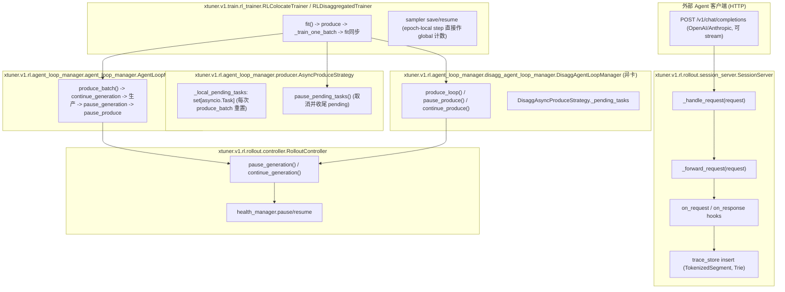
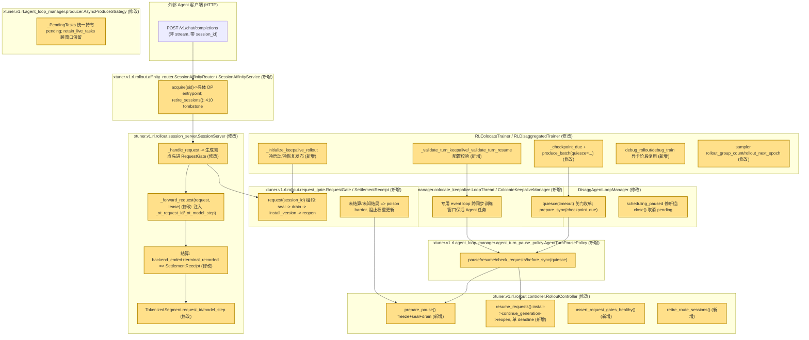

> Public copy of the real Kimi report. Only local run-directory labels were normalized; findings and conclusions are unchanged. The original report and CLI session are retained locally.

# review_2257_2026-11-11_21-26

审阅对象：#2257 本地拆分实际执行结果（base `f1fddc506a49b7d0aa71554e26908885b37211cc` → merged head `056e95c86a11318db22aafb69cfa6fbf1d9c31f6`）。本次为独立审阅：所有机械与代码结论均由本审阅在 `xtuner/` 仓库内用只读 git/源码核对得出，未继承任何前轮审阅意见；`MERGED_TO_EXPECTED.diff` 为空、报告中的 PASS 措辞未作为证据采信。

仓库内不存在 `GLOSSARY.md` 与 `docs/adr/`（已检查仓库根与 xtuner 子目录，明确标明：无）。架构评估使用 improve-codebase-architecture 的 module/interface/depth/seam/leverage/locality 词汇，未启动其交互 loop，未生成架构 HTML，未改 glossary/ADR。

---

## summary

**机械拆分（独立复核，全部静态确认，无阻断项）**

我在 `xtuner/` 内亲自执行了以下核对（非引用报告措辞）：

1. `git diff cdcaefd4cbc45ae01739e6615ee8e41046af49c5 HEAD` 为空 → 最终树与事先冻结的 expected_target **逐字相等**。
2. `git diff 43d62b6e1cbc59aea24c3c2ac5c7d65a90c8ecf4 HEAD` 只触及 `xtuner/v1/datasets/mllm_tokenize_fn/__init__.py` 一个文件；该文件与 base 的 diff 为空 → **唯一例外 = 批准的 tokenizer import fallback 排除**，其余 `xtuner/` 与原 head 无 diff（含新文件/mode）。
3. 六个 merge commit（`750b3b0a/9a32b6ed/9f892568/147c48a1/97efe2b5/056e95c8`）逐一 `git cat-file -p` 核对：均为双 parent、no-ff，第二 parent 依次为 T1-admin、T1-sampler、T1-finally、**T5-checkpoint（04 组 tip）**、T6-debug、peripheral，与 `MERGES.json` 一致；第一 parent 链为线性 stack。线性历史上恰为 10 个主体主题 commit + 1 个集中 tests/docs commit，全部落在 base 之上。
4. 逐 commit `--stat` 与 `COMMITS.json`/`HUNK_LEDGER.json` 的文件归属一致（166 个 hunk 全部有主题归属，`EDITS_UNASSIGNED.json` 实为归属前池，最终全部分配）。04 组五主题（T2-trace/T2-gate/T3-affinity/T4-lifecycle/T5-checkpoint）在组内是独立 review commit，但 stack 第 04 层只 merge 组 tip —— 与“中间 commit 是 review 单元、不承诺独立运行；04 组五主题共同合入”的口径一致，**不是隐藏行为**。
5. 未夹带额外提交：`base..HEAD` 仅含上述 17 个 commit（静态确认）。
6. 原副本保护：`ORIGINAL_SOURCE_PRESERVATION.json` 声明 head/refs/status/index 字节不变；本次审阅未对原副本做任何写操作（静态确认其存在且未被我触碰）。

**六层 stack/合入组合理性**：T1 三个小修复各自独立成层合理；T2-gate 依赖 T2-trace 的 `_xt_request_id` 注入与 provenance 字段，T3 的 retire 被 T2 的 probe 调用，T4 的 policy 调用 T2 的 `prepare_pause/resume_requests`，T5 的冷恢复发布复用 T2 barrier + T4 policy + T1-sampler —— 从实际代码调用关系看 04 组合组**确有真实跨主题启用/清理依赖**，不为强拆增 guard/no-op 的处理可以接受。tests/docs 集中一层携带符合“外围不要求一致、不为之增拆分负担”的约定。

**主体实现（base→merged，~2600 行源码）**：这是原 #2257 的实现本体，拆分未增删实现。因此实现层面的缺陷绝大多数属于**原 2257 已有设计**，不是本轮回归；下文章节严格区分。未发现高严重度的新增实际风险。

**高严重度实际风险：无（静态确认范围内）。**

**本轮拆分新增问题：仅 1 项低severity记录性事项**（见其他 issues O1：运行级 ACCEPTANCE 内 `replay.full_restore_verified=false` 与顶层 `full_Trainer_cold_restore=true` 措辞不一致；restore 段自身证据完整，属措辞而非证据缺口）。

**已有设计建议（原 2257 带入，不阻塞本轮）**：见“其他 issues”O2–O8，包括 Python 版本声明与 `asyncio.timeout` 不匹配、request-aware R3 显式 free 缺失、disagg `_fit` finally 行为变化、min_valid_attempts 计数口径等。

**GPU/validation 证据可支撑结论的边界**：GPU 实测树是 split + 固定 #2292 的叠加组合（`validation-xtuner` HEAD `414c0f43`，我在该仓库核对 `git log`/diff，叠加仅限 4 个 runtime 文件 + #2292 自带 tests/docs），**不冒充纯 2257 树**；该证据可支撑“叠加组合上 2 次真实 optimizer 更新、版本 0→1→2 发布、affinity、完整 DCP 冷恢复”等结论，**不可**外推为自然 CyberGym rollout、恢复后第三次更新、64 卡规模或任意单主题 commit 的独立验收。回放 fixture 路径（兼容 PT 未改字段、native loader CPU 预检）符合快速工作流，不要求重跑完整自然 rollout 是合理的；遗漏路径已在上文与 O9 明确。

---

## Main Flowchart before this PR

改动前（base `f1fddc50`）：共卡/异卡 RL 训练的原生 pause/resume 流程，Agent 执行随暂停被清理。



## Main Flowchart after this PR

改动后：新增 RequestGate 准入/结算屏障、affinity 路由、任务保活与 quiescent 保存恢复。突出显示为新增/修改节点（mermaid 8.8.0 `classDef changed`）。



文字对应说明（流程 → 修改代码）：

- 外部请求先进 affinity（新增 `affinity_router.py`，`RolloutProxyManager.replace_registered_session_urls` 改注册 affinity 入口，`acquire/retire_sessions`）。
- SessionServer 生成端点经 `RequestGate.request` 租约准入（`session_server.py:_handle_request` 修改；`_SESSION_SERVER_ONLY_KEYS` 增加 `_xt_request_id/_xt_model_step`；`_forward_request` 签名加 `lease`）。
- 结算：`backend_ended`（完整响应或 LMDeploy 上下文拒绝）+ 终态记录 → `SettlementReceipt`，否则 poison（`session_server.py` 租约块；`request_gate.py`）。
- 发布：`RolloutController.prepare_pause/resume_requests`（seal→drain / install→continue_generation→reopen，单 monotonic deadline；barrier 校验拓扑不变）。
- 保活：共卡 `ColocateKeepaliveManager`+`LoopThread` 使 `_PendingTasks` 中的活任务跨同步窗口存活（`producer.AsyncProduceStrategy._local_pending_tasks` → `_PendingTasks`，`retain_live_tasks`）；异卡 `DisaggAgentLoopManager.quiesce` + `AgentTurnPausePolicy.before_sync` 在 checkpoint 前关门收单。
- 保存/恢复：`Sampler` 持久化全局 group 计数与逻辑 epoch；`RLColocateTrainer._initialize_keepalive_rollout` 先封门→恢复→同步→发布版本；`RLDisaggregatedTrainer._resume_agent_loop_manager` 前置 `prepare_sync(False)+pause_produce`。
- 顺带小修复：proxy admin connect 重试（`misc._post_proxy_admin`）、fit 失败释放训练 batch（`_release_train_batch_resources` 进 finally）、sampler epoch 边界（T1）。
- 可选项：`min_valid_attempts` 过滤与 `agent_sandbox_env_id` 元数据（T7）。

---

## 核心原理

1. **准入-结算屏障**：RequestGate 用 asyncio.Condition 维护 `_open/_epoch/_active/_failures`。每个生成请求持有 RequestLease；请求结束必须留下 `SettlementReceipt(backend_ended, terminal_recorded)`。任何“未知后端结局”（超时、断连、取消、trace 提交失败）都把 gate 置为失败态，此后 drain/install/reopen/新准入全部拒绝 —— 权重更新只发生在所有准入请求都“确定结束”之后。LMDeploy 的“input length >= context length”400 是唯一被白名单化的“生成前拒绝”，视为安全结束的失败尝试（`session_server._is_lmdeploy_context_rejection`，正则钉死 pinned LMDeploy 的 payload）。
2. **版本发布协议**：`prepare_pause` 冻结拓扑→向所有 entrypoint 发 seal→drain（一个 deadline）；训练/同步后 `resume_requests` 校验 barrier 与 entrypoint 集合不变 → 所有 entrypoint install 新版本 → 所有后端 continue_generation → 所有 entrypoint reopen，全程共享一个 monotonic deadline。任一失败保留 barrier、不开门（fail-closed）。
3. **跨窗口任务所有权**：活 Agent 任务始终由 producer 既有的 `_PendingTasks` 拥有。共卡模式用独立线程事件循环（`LoopThread`）在同步 GPU 训练期间维持工具/HTTP 客户端推进；`retain_pending_tasks` 只收割已完成任务，不取消活的。异卡模式 `quiesce` 停止新组、等生产者收单、在 gate 仍开时让 episode 自然收尾。
4. **trace/R3 共享所有权**：带 `request_id` 的 TokenizedSegment 与 rollout state 的 `routed_experts` 为共享借用 —— `RolloutState.reset_response/free_rollout_state_refs` 与 `Trie.release` 都跳过 request-aware 引用的显式 free，避免训练侧仍借用时释放。
5. **冷恢复发布**：冷启动/恢复的 SessionServer 以 `turn_resume_initially_closed` 出生（配置校验器设置），权重与 manager 状态就绪后才 publish 实际版本，杜绝“版本 0 准入旧权重引擎”。

## 核心实现与对应的单测

| 核心实现 | 对应单测 | 原理核验 |
| --- | --- | --- |
| `request_gate.py` RequestGate 租约/seal/drain/install/reopen | `tests/turn_resume/test_request_gate.py`（7 项） | 静态读码确认 poison 语义、`TimeoutError` 不计 inflight、epoch 幂等；与测试断言一致 |
| `session_server.py` 租约接线+结算+LMDeploy 拒绝白名单 | `tests/turn_resume/test_forwarding.py`（10 项，真实 aiohttp TestServer） | 关键细节已独立复核：trace 失败时 `backend_ended=complete=True`（`complete` 不含 session_error_msg 条件），故 `Receipt(True,True,"failed")` 是 safe —— drain 可通过，符合“安全失败尝试”设计；`response.body` 覆写 id 走 aiohttp `Response.body` setter（同步 content-length），测试覆盖 |
| `controller.py` prepare_pause/resume_requests | `tests/turn_resume/test_policy.py::ControllerTests`（5 项） | seal 全发再 drain、install→continue→open 顺序、deadline 耗尽不开门、拓扑变化拒绝发布，均有断言 |
| `affinity_router.py` | `tests/rl/test_affinity_router.py`（3 项，真实 loopback HTTP） | 绑定跨 publication 不动、backend 失效 fail-closed、tombstone 410、无重放 |
| `colocate_keepalive.py` LoopThread/ColocateKeepaliveManager | `tests/rl/test_colocate_keepalive.py::OwnerTests/StartupTests` | 主线程被同步训练阻塞时任务仍在 owner loop 推进；恢复/同步失败保持关门并关闭 owner |
| `agent_loop_manager.py` produce_batch quiesce 路径 | `test_colocate_keepalive.py::BoundaryTests` | quiesce 时 gate 开着收单、drain 失败不回原生训练 |
| `disagg_agent_loop_manager.py` quiesce/close/prepare_sync | `tests/turn_resume/test_quiesce.py`（4 项） | 不丢不取消活 episode、`_producer_idle` 等待、超时安全 |
| `sampler.py` 全局计数/epoch | `tests/turn_resume/test_sampler_resume.py` | 新旧 checkpoint 均恢复后缀与唯一 id（含真实 ParallelSampler shuffle） |
| `trace_store.py` request-aware 引用/三版本导出 | `tests/turn_resume/test_trace_provenance.py`、`test_main_compatibility.py` | 三版本 append 不替换旧 route/logprob、冲突写拒绝、release 不递归、普通 ref 释放而借用保留 |
| `misc._post_proxy_admin` | `tests/rl/test_proxy_admin_connect_retry.py`（AST 抽取真函数） | 仅 connect timeout 重试 5 次、read timeout 不重试 |
| 配置校验器 `_validate_turn_keepalive/_validate_turn_resume` | `test_colocate_keepalive.py::CompatibilityTests` | gate/keepalive 成对、fixed topology、禁评估、resume 约束 |
| checkpoint 物化（routed_experts/replay/sampler） | `CheckpointDataTests` | DCP payload 中 SerializedRayObjectRef、恢复后哈希一致、replay 未持久化报错 |

静态确认：以上测试与实现逐一对得上，且 CPU 验收（130 项，host 环境）覆盖的是这些文件。

## 抽象与信息隐藏评估

（按 module/interface/depth/seam 词汇）

- **RequestGate 是深 module**：接口 5 个异步操作 + 1 个 snapshot，隐藏了租约字典、epoch 校验、poison 传播全部复杂度；`SettlementReceipt` 是不可变值对象。leverage/locality 好，测试通过接口完成。这是本次最好的抽象。
- **SessionAffinityRouter 同为深 module**：`acquire/set_backend/retire_sessions/replace_backends/handle/start/stop` 背后隐藏 inflight/assigned 计数、tombstone、流式转发与“绝不重放 POST”的语义。`SessionAffinityService` 是独立事件循环 adapter，seam 清晰（proxy_manager 通过 `invoke` 调用，可替换）。
- **AgentTurnPausePolicy / DrainPendingPausePolicy** 构成一个真实 seam（两个 adapter：原生 drain 策略与 turn-resume 策略），`DisaggProduceStrategy.configure_turn_resume` 以“不支持的策略在构造期拒绝”保护启用路径 —— 多态消分叉做得对（满足新增功能守则 R3）。
- **ColocateKeepaliveManager 偏浅**：`__getattr__` 透传 + 4 个具名方法转发（produce_batch/save/resume/prepare_initial_sync/publish_initial_version），接口几乎等于实现。但它确实是“第二个 adapter + 线程所有权”的薄壳，删除它会把线程所有权逻辑散回 trainer —— deletion test 勉强通过。可接受，见“单测建议”S4。
- **瑕疵（低风险，既有）**：`AgentLoopManager.produce_batch` 的 keepalive 分支直接伸手 `task.produce_strategy._pending_tasks`（私有字段），且 `ColocateKeepaliveManager` cleanup 也遍历 `_pending_tasks` —— 生产策略的内部结构泄漏到 manager 层（违背 R2）。T4 主题内一致，非本轮新增。

## 新增功能守则

对既有类的接触点核查（T2–T7 相对既有类）：

- **AgentInSandboxLoop**（既有类）：新增 3 个构造参数 + `generate_sample` finally 中 1 次具名调用（`retire_route_sessions`）+ `_build_rollout_states` 内 `require_turn_provenance` 分支（约 25 行实现细节：versions 长度校验、request_ids 匹配、trace 校验）。**R1 满足（≤1 字段级接触 + 1-2 次调用），R2/R3 部分违反**：`_build_rollout_states` 内的 provenance 校验块把字段名（`token_model_steps/request_ids/routed_experts`）与 trace 语义写进了既有类。伪代码改进（后续可选，非本轮）：
  ```python
  # 下沉到新增的 provenance 校验器，既有类只留一次调用
  if self.require_turn_provenance:
      segment_state = self._turn_provenance.attach(segment_state, data, item, rollout_state)
  ```
- **RolloutController**：新增 5 个公开方法 + 2 个字段，既有方法仅 3 处小改（pause_generation 的 barrier 抛错、continue_generation 的条件 resume、shutdown finally 关 proxy）。R1/R3 满足。
- **SessionServer**：构造参数 +2、`_handle_request` 前置 gate 分支、`_forward_request` 加 lease 参数与 3 处小挂钩、`_on_response_worker`（新 `_xt_request_id` 终态校验）。既有流程未按新特性分叉成两套 —— 租约为 None 时行为不变，**R3 满足**。
- **AsyncProduceStrategy**：`_local_pending_tasks` set → `_PendingTasks` 是行为中性重构（普通路径语义不变，`retain_live_tasks=False` 默认），接触点合理。
- **RolloutProxyManager**：affinity 分支 3 处 if/else（`replace_registered_session_urls/on_worker_group_inactive/on_worker_group_active`）**轻微违反 R3**（null object 可用“无 affinity 时直连注册”的 no-op adapter 消掉）；低风险，既有设计。

## 公开接口的线性业务流程评估

- `RequestGate.request/seal/drain/install_version/reopen` 每个方法都是单抽象层级的线性流程，无转发 wrapper；`drain` 的“等待→超时置失败→抛错”集中一处，locality 好。
- `RolloutController.prepare_pause/resume_requests`：prepare_pause = freeze→取 entrypoints→建 barrier→seal→drain，线性；`resume_requests` 用内部 `wait_all` 闭包消除 deadline 重复，符合 Composed Method；失败路径统一 raise，无静默吞错。
- `SessionServer._forward_request` 仍是长方法（base 已如此），本轮在其上叠加租约/计时/结算约 60 行，进一步拉长 —— 属既有债务加重而非新债；建议（后续）把“租约结算块”抽为 `_settle_lease(lease, ...)` 私有方法，可隐藏真实规则、提高 locality。
- `AgentLoopManager.produce_batch` 的 keepalive 分支插入了 quiesce 内联闭包 `finish_live_tasks`（25 行），使该方法从“线性叙述”变成双路径 —— 建议（后续）抽 `_finish_live_tasks_for_quiesce(...)`，与 deletion test 一致（删除后复杂度集中在 manager 一处）。

## 单测建议

现有测试已较完整（上表）。补充建议（均为静态推断，优先级低）：

- S1（对应 O2）：若保留 `requires-python>=3.10`，加 `sys.version_info<(3,11)` 的兼容层或把声明抬到 >=3.11；最小测试 = import `request_gate` 后在 3.10 环境构造 RequestGate。
- S2（对应 O5）：`_drop_failed_train_samples` 在 valid 样本缺少 `agent_session_id` 且 `min_valid_attempts=2` 时的组命运（当前会按 1 个独立尝试整组 FILTERED）。
- S3（对应 O4）：长会话下 affinity `retired` tombstone 集合只增不减的容量行为（`max_sessions` 触顶 503）。
- S4（对应抽象评估）：为“manager 不碰 `_pending_tasks` 私有字段”加一个 seam 级测试，倒逼 strategy 暴露 `quiesce(ctx)`/`claim_ready` 公开接口。
- S5：`RLColocateTrainer.fit` cleanup 失败 + 原始异常并存时 cleanup 异常被吞的断言（当前无测试覆盖该组合）。

## 其他 issues

**O1（低，静态确认，本轮拆分新增）**：`recorded-run/ACCEPTANCE.json` 的 `replay.full_restore_verified=false` 与同文件 `restore.passed=true/full_trainer_cold_restore=true` 及顶层 `QUICK_GPU_ACCEPTANCE.full_Trainer_cold_restore=true` 措辞冲突。实际冷恢复证据在 restore 段（optimizer_step=2、管理器状态、恢复后真实 HTTP 响应）。建议把 replay 段该字段改名为 `not_applicable_to_replay_phase` 或统一口径，避免读者误读为“恢复未验证”。

**O2（中，静态确认，原 2257 带入）**：Python 版本声明不匹配。`pyproject.toml requires-python = ">=3.10"`，但 merged 树新增 3 处 `asyncio.timeout`（仅 3.11+）：`request_gate.py:61,94`、`disagg_agent_loop_manager.py:309`（base 全仓零使用，已用 `git grep` 于 base 确认）。实测环境为 Python 3.12（已核对解释器版本），故未暴露；3.10 用户启用 turn-resume 即 AttributeError。建议抬声明或加 `async_timeout` 兼容。非本轮回归，不在拆分中修符合口径。

**O3（低，静态确认，原 2257 带入）**：异卡 `_fit` finally（`rl_trainer.py:2092-2098`）由 `await producer_task` 改为 cancel + `agent_loop_manager.close()`，影响**所有**异卡运行（非仅 debug/turn-resume）：普通路径 producer 若仍在批中会被即刻取消而非自然收尾；`close()` 抛错会掩盖原始异常。T6 主题内行为，建议后续给普通路径保留 graceful 收尾分支。

**O4（低，静态确认，原 2257 带入）**：request-aware 的 `routed_experts` Ray 引用全链路无显式 free（`rl_data.reset_response` 跳过、`free_rollout_state_refs` 置 None 不 free、`Trie.release` 跳过 request-aware 段），依赖 Ray 分布式 GC 惰性回收。短程无感，长程 turn-resume 训练有 object-store 压力风险。建议后续在 trace 退休链路补一次 owner 明确的 free。

**O5（低，静态确认，原 2257 带入）**：`min_valid_attempts` 以 distinct `agent_session_id` 计独立尝试；valid 样本缺该字段时全部归一为 None 只算 1 个，`min_valid_attempts=2` 会把本可训练的组整组 FILTERED。配置校验未把它与 `require_turn_provenance` 绑定。recipe 当前显式用 =2 且 provenance 开启，短期不触发；建议文档注明或校验联动。

**O6（低，静态确认，原 2257 带入）**：`produce_utils.BaseProduceContext.generate_group` 全局（非 opt-in）给每个生成样本写 `extra_fields["new_response_tokens"]`，改变 produced-token 记账口径且该内部键会随 extra_fields 进 replay/checkpoint/debug pt。有单测锁定新口径（`test_complete_provenance_does_not_erase_generated_token_count`），属设计选择；建议键名加 `_` 前缀并文档化。

**O7（信息，静态确认）**：`agent_turn_lifecycle.md` 明确声明多 entrypoint reopen 非原子、partial RPC 可能留开着的 gate、license/来源（matrix72c/sandbox_rl 参照、Lagent #385 依赖、#2289 不包含）——披露充分，与代码行为一致；维护者需按文档处理来源许可。

**O8（信息，静态确认）**：T2-trace 与 #2252 的 Trie 遍历重叠按“标记重叠、不换实现”处理；`Trie.keys/release` 的迭代化改写确在 2257 主体内（已读 merged `trace_store.py` 232-240 行确认无递归），与 #2252 目的重叠但引用语义不同（request-aware 跳过 free），整文件互换会改变 R3 所有权 —— 计划的处理成立。

**O9（验证边界汇总，静态确认 + 推断）**：可支撑——机械相等（我独立复核）、叠加 #2292 组合上 2 次真实 optimizer 更新/冻结 MTP 全量哈希不变/IPC 同步/版本 0→1→2/affinity 绑定/受控任务跨更新续跑/完整 DCP 冷恢复后真实 HTTP；runner（`quick_gpu/gpu_jobs/config.py` 等）走原生 `build_config` 校验器并断言 keepalive/冻结/closed gate，fixture PT 未改字段（`GPU_PT_COMPATIBILITY_V3.unchanged_fields` + sha256）。不可支撑/未覆盖——自然 CyberGym 工具评分路径、恢复后第三次更新、optimizer moments 逐元素审计、64 卡长程、多 DP entrypoint 下的 partial-reopen 故障注入、Python 3.10、每主题 commit 独立运行。这些已在 REPORT/ACCEPTANCE 中如实标注，本审阅认可其边界表述。

---
审阅执行说明：全程只读（git show/diff/cat-file、源码阅读、JSON 证据读取），唯一写入为本报告。未运行项目代码（依原文第 6 条），未改任何 git refs/index，未 push/评论/merge，未操作 RJob/SSH/权重。中间产物（prompt 快照、SCOPE、diff、日志、metadata）按要求全部保留，未做清理。
