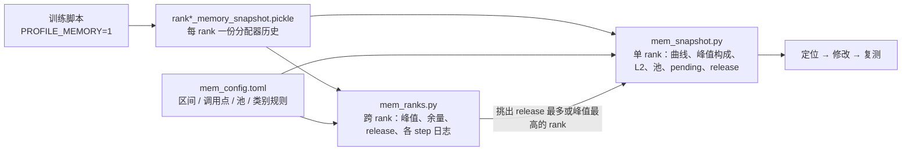
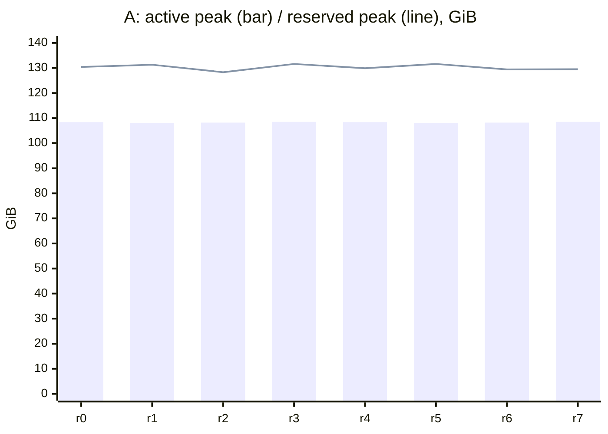
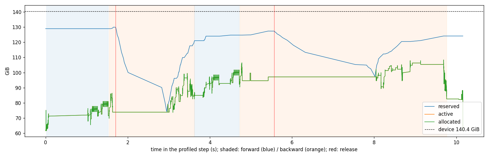
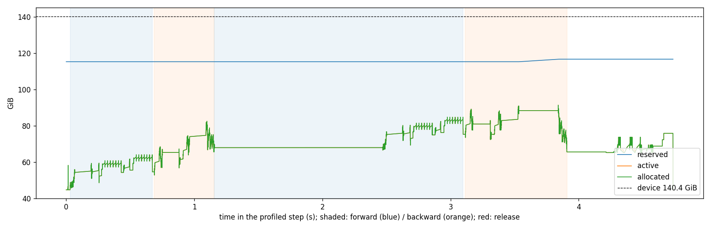
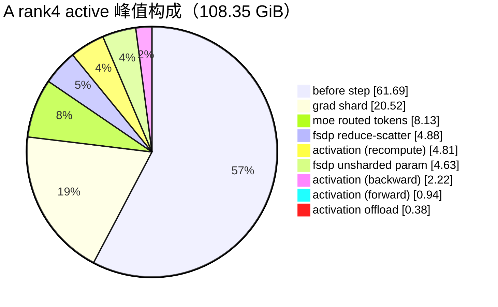
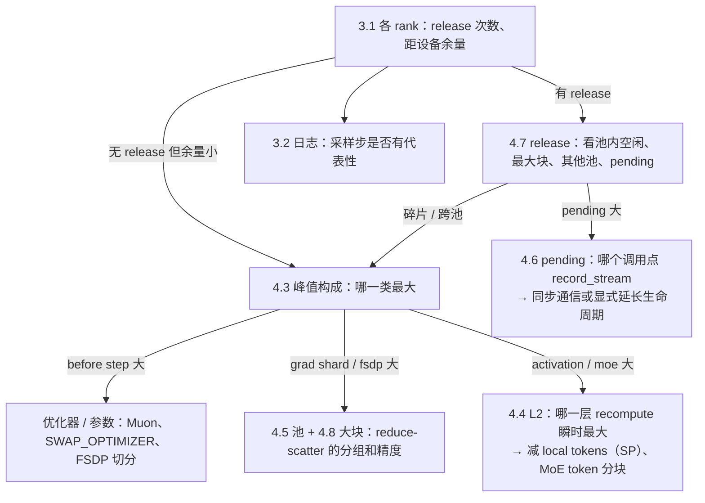

# XTuner 显存 profile 指南：以单机 8 卡 GLM-5.2-30B 为例

本文介绍 `profile/` 下两个显存分析脚本的用法、报告里每张表和图的含义，以及怎样从报告走到具体的优化动作。示例是单机 8 卡
GLM-5.2-30B（5 层：3 dense + 2 MoE，外加 1 层 MTP），负载与 `doc/guide_profile_time.md` 相同，完整走了一遍
“profile → 定位 → 修改 → 复测”。

结论：

1. **工具链由 2 个脚本和 1 个规则文件组成。** `mem_ranks.py` 负责跨 rank 对比：看哪个 rank 触顶、有没有分配器卡顿，以及采样的那一步是否有代表性；
   `mem_snapshot.py` 看单个 rank 的一步：显存曲线、峰值构成、各层增量、分配池、pending 释放、`release_cached_blocks`
   的成因。调用点、类别、池名等规则都放在 `mem_config.toml` 里。
2. **示例 A（AdamW）：8 个 rank 中有 5 个出现分配器全量释放（共 6 次），每次卡住 host `1.3–3.0s`。** reserved 峰值
   `128–132 GiB`，离设备上限只剩 `9–12 GiB`；触发 release 的都是 FSDP reduce-scatter 的 `5.02 GiB` 请求。卡顿有两种成因：
   一是 compute 池里空着 `20.9 GiB`，但最大的一块只有 `4.2 GiB`，属于碎片；二是 reduce-scatter 池里只空着 `2 GiB`，而其他池空着
   `28 GiB`，属于跨池。pending 块为 0，和 512K 的成因（DeepEP 的 `record_stream`）不同。
3. **示例 B（换成 Muon，其余不变）：常驻显存少 `17 GiB`，release 降为 0。** active 峰值从 `108.4` 降到 `91.4 GiB`，reserved 峰值
   从 `~130` 降到 `~116 GiB`；干净 step 从 `7.1–12.9s` 降到 `3.6s`，与 time profile 的结论一致。
4. **B 的峰值构成：** 常驻显存 `44.7 GiB`（49%）；fp32 梯度分片 `20.5 GiB`（22%），从第一个 micro-batch 的反向一直留到 `zero_grad`；其余是
   MoE 路由 token、重算激活和 FSDP 通信缓冲区。要继续降显存，就从这几项入手（见第 5 节）。



## 1. 工具与计数器

| 文件 | 输入 | 输出 | 回答的问题 |
|---|---|---|---|
| `profile/mem_ranks.py` | `profiling_memory/step-N/`，可选 `--logs` | Markdown：各 rank 表 + 柱线图，各 step 日志表 | 哪个 rank 最先触顶、谁有分配器卡顿、有没有泄漏；采样步和相邻 step 是否一致 |
| `profile/mem_snapshot.py` | 一个 snapshot 或 step 目录加 `--rank` | Markdown 报告（8 节，含 Mermaid 曲线和饼图），可选 `--png` 曲线 | 这一步的显存花在哪、峰值时刻有什么、哪一层涨得最多、分配器为什么卡住 |
| `profile/mem_config.toml` | — | — | L1/L2 区间、调用点、池名和类别的规则，以及设备容量和报告阈值 |
| `tests/test_profile_mem.py` | — | — | 合成 snapshot 覆盖计数器、峰值构成、pending 和 release 归因；GPU 用例在真实分配器上复现一次 release |

报告里的三个计数器与 `torch.cuda.memory_stats` 的含义一致：

| 计数器 | 何时增加 / 减少 | 含义 |
|---|---|---|
| allocated | `alloc` / host 释放 tensor（`free_requested`） | 活着的 tensor |
| active | `alloc` / 块真正可以复用（`free_completed`） | allocated 加上 pending 的块；`active − allocated` 就是 pending |
| reserved | `segment_map` / `segment_unmap`（expandable segments），非 expandable 模式下为 `segment_alloc` / `segment_free` | 分配器向驱动申请到的显存 |

L1 / L2 区间与 time profile 相同：`xtuner.L1.*` 是训练循环的阶段（`forward.i`、`backward.i`、`clip`、`optimizer`……），
`xtuner.L2.*` 是层和模块（`layer4.recompute`、`mtp1.backward`、`loss.chunk_forward`……）。L2 的层号从 1 开始：本例中
`layer1–3` 是 dense 层，`layer4–5` 是 MoE 层，`layer6` 是 MTP 里的 decoder 层。

## 2. 采集

| 环境变量 | 本例 | 说明 |
|---|---|---|
| `PROFILE_MEMORY=1` | 1 | 打开显存 profile：记录一整步的分配器事件和 Python 栈 |
| `PROFILE_STEP` / `PROFILE_MEMORY_STEP` | `4` | 从 0 开始计数：`4` 对应日志里的 Step 5，目录为 `profiling_memory/step-4`。`PROFILE_MEMORY_STEP` 可以和 `PROFILE_TIME_STEP` 设成不同的 step，同一次运行里两种 profile 互不干扰 |
| `PROFILE_RANKS` | `all` | 单机全采；多机时建议采一个 EP 组加一个 FSDP 组 |
| `PYTORCH_CUDA_ALLOC_CONF` | `expandable_segments:True` | `sft_glm_tiny.sh` 的默认值。两种模式脚本都支持 |

启动脚本为 `.scratch/guide_profile_mem/launch_glm30b_mem.sh`，封装了 `sft_glm_tiny.sh`：

```bash
export CONDA_ENV=pt29_glm2
export DISPATCHER=deepep EP_SIZE=4 SP_SIZE=2
export DATASET_TYPE=alpaca_long SAMPLE_MAX_LENGTH=8192 PACK_MAX_LENGTH=32768 GLOBAL_BATCH_SIZE=8   # 每个 DP rank 2 个 micro-batch
export SPARSE_MLA_BACKEND=cudnn_dsa INDEXER_BACKEND=cute_dsl
export TOTAL_STEP=6 PROFILE_MEMORY=1 PROFILE_STEP=4 PROFILE_RANKS=all
export OPTIMIZER=adamw                      # 示例 A；示例 B 为 OPTIMIZER=muon
bash sft_glm_tiny.sh                        # FP8、activation offload、recompute 等沿用脚本默认值
```

| 运行 | 目录 | snapshot | 各步墙钟（s，Step 2–6） |
|---|---|---|---|
| A：AdamW | `work_dirs/guide_profile_mem_0923/glm30b_adamw/20260923175615` | 每 rank `3.5 MB`、`~2 万`个事件 | `10.43 / 7.13 / 9.44 / 10.23（采样） / 12.86` |
| B：Muon | `work_dirs/guide_profile_mem_0923/glm30b_muon/20260923180023` | 同上 | `6.64 / 3.58 / 3.62 / 4.81（采样） / 3.58` |

两个脚本都是纯 Python 回放，速度很快：本例 8 个 rank 的 `mem_ranks.py` 用时 `1.9s`；512K/SP8 的单 rank snapshot（`117 MB`、百万级事件）
跑 `mem_snapshot.py` 约 `15s`。

## 3. 跨 rank：`mem_ranks.py`

```bash
python profile/mem_ranks.py $RUN/profiling_memory/step-4 --out ranks.md      # 日志默认读 $RUN/logs
```

### 3.1 各 rank 的显存

示例 A（AdamW）：



| rank | active 峰值 | reserved 峰值 | 距设备 | active 峰值时刻 | release | unmap GiB | 同时 pending 峰值 | active 结束−开始 |
|---:|---:|---:|---:|---|---:|---:|---:|---:|
| 0 | 108.37 | 130.39 | 10.01 | 8.8s backward.1 layer4.backward | 1 | 35.38 | 0.59 | 0.00 |
| 1 | 108.15 | 131.31 | 9.09 | 8.7s backward.1 layer4.backward | 0 | 0.00 | 0.19 | 0.00 |
| 2 | 108.21 | 128.32 | 12.08 | 4.8s backward.1 layer6.backward | 1 | 30.96 | 0.19 | 0.00 |
| 3 | 108.48 | 131.60 | 8.80 | 8.7s backward.1 layer4.backward | 0 | 0.00 | 0.19 | 0.00 |
| 4 | 108.35 | 129.88 | 10.52 | 9.7s backward.1 layer4.backward | 2 | 85.58 | 0.19 | 0.00 |
| 5 | 108.13 | 131.56 | 8.84 | 8.9s backward.1 layer4.backward | 0 | 0.00 | 0.19 | 0.00 |
| 6 | 108.21 | 129.41 | 10.99 | 4.8s backward.1 layer6.backward | 1 | 31.92 | 0.82 | 0.00 |
| 7 | 108.53 | 129.53 | 10.87 | 9.7s backward.1 layer4.backward | 1 | 32.12 | 0.19 | 0.00 |

示例 B（Muon）的 8 个 rank：active 峰值 `91.2–91.5`，reserved 峰值 `114.5–118.4`，距设备 `22.0–26.0 GiB`，release 全部为 0。

读法：

- **`release` 不为 0 的 rank 会卡住 host，其余 rank 在下一次集合通信里等它。** A 中 5 个 rank 各自在不同时刻卡住，
  8 个 rank 就轮流被拖慢。这和 time profile 里 “6 个 rank 有 `0.8–2.7s` 的 `aten::empty_strided`” 是同一件事。
- **active 峰值在各 rank 间只差 `0.4 GiB`，reserved 峰值却差 `3.3 GiB`。** 真正决定会不会触顶的，是 reserved 与 active 之间的缓存
  （碎片和各池的余量），这部分在 rank 之间差异更大。所以不能只看 `max_memory`。
- `active 结束−开始` 为 0，说明一步之内没有泄漏。
- `同时 pending 峰值` 很小（`0.2–0.8 GiB`），主要是 activation offload 预取的块，和 512K 的情况相反（见 4.6 节）。

### 3.2 各 step 的显存（训练日志）

| step | profiled | time_mean_s | time_max_s | max_memory_max | reserved_mean | reserved_max | reserved_max_rank |
|---:|---|---:|---:|---:|---:|---:|---:|
| 1 |  | 68.78 | 70.59 | 88.22 | 106.04 | 106.04 | 0 |
| 2 |  | 10.43 | 10.98 | 108.83 | 130.56 | 131.39 | 2 |
| 3 |  | 7.13 | 7.14 | 108.65 | 131.24 | 131.56 | 5 |
| 4 |  | 9.44 | 9.45 | 108.68 | 130.72 | 131.56 | 5 |
| 5 | ← | 10.23 | 10.25 | 108.53 | 130.25 | 131.60 | 3 |
| 6 |  | 12.86 | 12.87 | 108.70 | 130.77 | 131.60 | 3 |

读法：日志里每步打印的 `max_memory` / `reserved_memory` 是 `torch.cuda` 的峰值，单位写作 GB，实际是 GiB（与 snapshot 的
`108.37` 对得上）。采样步（←）的峰值和相邻 step 一致，说明这一步有代表性。A 的 step 时间在 `7–13s` 之间波动，正是 release
随机出现在不同 rank 上的表现；B 的干净 step 稳定在 `3.6s`。Step 1 包含编译和缓存预热，不作参考。

## 4. 单 rank：`mem_snapshot.py`

```bash
python profile/mem_snapshot.py $RUN/profiling_memory/step-4 --rank 4 --out snapshot.md --png curve.png
```

下文以 A 的 rank4 为例（它有 2 次 release，两种成因都有），对照 B 的 rank0。

### 4.1 概览

| 指标 | A 开始 | A 峰值 | B 开始 | B 峰值 |
|---|---:|---:|---:|---:|
| allocated | 61.70 | 108.35 | 44.72 | 91.41 |
| active | 61.70 | 108.35 | 44.72 | 91.41 |
| reserved | 128.91 | 129.88 | 115.33 | 116.74 |

| 项 | A | B |
|---|---|---|
| reserved 峰值距设备 | 10.52 GiB | 23.66 GiB |
| release_cached_blocks | 2 次，unmap 85.6 GiB | 0 |
| segment map（向驱动申请显存） | 80.8 GiB | 1.4 GiB |
| pending 释放 | 1 次，0.19 GiB | 1 次，0.19 GiB |

读法：开始时的 allocated 就是跨 step 常驻的显存（参数分片、优化器状态等）。A、B 相差 `16.98 GiB`，正好是 AdamW 比 Muon 多出的一份
fp32 优化器状态，峰值也相应差了这么多。`segment map` 是一步里向驱动重新申请的量：正常情况下应接近 0，A 中的 `80.8 GiB` 全是 release 之后重新 map 的。
报告还给出三个峰值各自所在的时刻，以及当时的事件和调用点：A 的 active 峰值出现在 `backward.1 / layer4.backward` 的一次 MoE
GEMM 分配上。

### 4.2 一步内的显存曲线

A（rank4，`--png` 输出）：



B（rank0）：



报告里还有同一条曲线的 Mermaid 版本（`chart_points` 个采样点），不依赖图片也能看。A 的 L1 阶段表：

| L1 | t0_s | dur_s | allocated 开始 | allocated 结束 | active 峰值 | reserved 峰值 | release |
|---|---:|---:|---:|---:|---:|---:|---:|
| fp8_scale | 0.01 | 0.00 | 61.70 | 61.70 | 75.20 | 128.91 | 0 |
| forward.0 | 0.02 | 1.50 | 61.70 | 71.56 | 81.04 | 128.91 | 0 |
| backward.0 | 1.55 | 2.08 | 71.56 | 82.59 | 99.50 | 129.88 | 1 |
| forward.1 | 3.63 | 1.09 | 82.59 | 92.27 | 101.74 | 124.67 | 0 |
| backward.1 | 4.73 | 5.04 | 92.27 | 82.59 | 108.35 | 127.32 | 1 |
| post_micro | 9.77 | 0.30 | 82.59 | 82.59 | 82.59 | 124.08 | 0 |
| optimizer | 10.13 | 0.03 | 82.22 | 82.22 | 88.22 | 124.08 | 0 |
| zero_grad | 10.16 | 0.00 | 82.22 | 61.70 | 82.22 | 124.08 | 0 |

读法：

- **曲线上的红线就是 release。** reserved 在 `1.7s` 从 `130` 一路降到 `74 GiB`，之后才重新 map 回来；这段时间里 allocated
  完全不动（`1.7–3.0s`、`5.6–8.0s`），说明 host 被卡住了。B 的 reserved 基本是一条水平线。
- **`forward.i` 结束时 allocated 的净增量，就是这个 micro-batch 留给反向的激活**：两个 micro-batch 都是 `~9.8 GiB`。
- **`backward.0` 结束时 allocated 反而多了 `11 GiB`**，这是梯度：第一个 micro-batch 的反向生成 fp32 梯度分片，一直留到
  `zero_grad` 才释放（`82.22 → 61.70`，正好是 4.3 节的 `grad shard 20.52 GiB`）。
- `fp8_scale` 在步首有一个 `+13.5 GiB` 的瞬时峰（其中一次 `9 GiB` 的分配），但不在全步峰值上，不影响触顶。
- A 的 `optimizer` 只要 `0.03s`、`+6 GiB` 瞬时；B 的 Muon 要 `0.47s`、`+10.6 GiB` 瞬时。换优化器省下的是常驻显存，瞬时开销反而更大。

### 4.3 active 峰值时刻的构成



| category | A GiB | B GiB | 说明 |
|---|---:|---:|---|
| before step | 61.69 | 44.72 | 这一步开始前就在的块，汇成一行（参数分片、优化器状态等） |
| grad shard | 20.52 | 20.52 | FSDP `_to_dtype_if_needed` 生成的 fp32 梯度分片，由 reduce-scatter 的 stream 分配 |
| moe routed tokens | 8.13 | 8.15 | permute / 分组 GEMM 的 token 缓冲区 |
| fsdp reduce-scatter | 4.88 | 4.88 | 当前层 reduce-scatter 的输入 |
| activation (recompute) | 4.81 | 4.82 | 当前层重算出来的激活 |
| fsdp unsharded param | 4.63 | 4.63 | all-gather 出来的未分片参数 |
| activation (backward) / (forward) | 3.16 | 3.16 | 反向的临时块、checkpoint 保存的层输入 |

报告里还有两张表：按分配时所在的 L2 区间分组，以及按调用点分组（`site` 是最内层的非框架帧，`caller` 是最内层的项目帧）。
例如 `float8_gmm_tile_wise.py:367:forward` 在峰值时占 `5.06 GiB`，`_fsdp_param.py:869:alloc_storage` 占 `4.23 GiB`。

读法：A 和 B 的差别只在 `before step`，其余各项逐行相同。这说明换优化器只改变了常驻显存，没有动到激活和通信缓冲区。
要继续降峰值，按占比从大到小排：常驻显存 > 梯度分片 > MoE token > FSDP 通信缓冲区 > 重算激活。

### 4.4 各 L2 区间（层 / 模块）

| L2 | 次数 | 结束时净增 allocated（均值） | 区间内瞬时增量（最大） | active 峰值 |
|---|---:|---:|---:|---:|
| layer4.recompute（MoE） | 2 | 8.73 | 12.74 | 107.85 |
| layer4.backward（MoE） | 2 | -3.44 | 4.46 | 108.35 |
| layer6.recompute（MTP 的 MoE 层） | 2 | 9.21 | 13.88 | 105.90 |
| mtp1.recompute | 2 | 9.77 | 10.04 | 101.93 |
| loss.chunk_forward | 4 | 4.94 | 8.48 | 101.74 |
| layer3.recompute（dense） | 2 | 4.60 | 5.79 | 98.85 |
| layer4.forward（MoE） | 2 | 0.22 | 6.13 | 97.17 |
| layer1.forward（dense） | 2 | 0.31 | 2.98 | 86.95 |

读法：

- **forward 的净增量很小（`0.2–0.3 GiB`），因为 checkpoint 只保存层输入。** 真正的激活开销出现在 recompute：MoE 层重算净增
  `8.7 GiB`、瞬时 `12.7 GiB`，是 dense 层的两倍。
- **瞬时增量决定了峰值。** 按 `active 峰值` 排序，第一行就是峰值出现的区间，它的瞬时增量就是这个区间在常驻显存之上额外需要的量。
  例如想评估 “减小 MoE 层重算的临时块” 能省多少，看的就是 `layer4.recompute` 的 `12.74`。
- 层数很多时（78 层），同类层会合并成 `layer*.recompute` 这样的行（区间名多于 40 种时自动合并）。

### 4.5 分配池

| pool | A reserved 峰值 | B reserved 峰值 | 累计分配 GiB |
|---|---:|---:|---:|
| compute | 94.57 | 78.96 | 950 / 1159 |
| fsdp reduce-scatter | 28.11 | 30.00 | 61.6 |
| fsdp all-gather | 7.78 | 7.78 | 85.7 |

读法：缓存分配器每个 CUDA stream 一个池，一个池里的空闲块不能给另一个池用。**reduce-scatter 池占了 `28–30 GiB`**：梯度分片
（`20.5 GiB`）就在这个池里，再加上 fp32 转换的临时块。池名来自规则文件里的 `[pool]`：旁路 stream 的名字取自在它上面分配字节数最多的调用点。

### 4.6 pending 释放

| pool | site | 次数 | 单块_GiB | 等待中位_ms |
|---|---|---:|---:|---:|
| compute | `activation_offload.py:145:prefetch_launch_h2d` | 1 | 0.19 | 10.45 |

读法：对 tensor 调用过 `record_stream` 之后，host 释放它时，这块显存要等登记的 stream 在 GPU 上执行到释放点才能复用，中间这段时间它就处于 pending 状态。
本例只有 offload 预取的一块。作为对比，512K/SP8 的 rank0（`doc/01_sft_glm_512k_mem.md`）用同一个脚本得到的是
`12,835` 次 pending 释放、最多同时 pending `21.5 GiB`，全部来自 DeepEP 的通信缓冲区。那里的解决办法是 P0-c（同步 DeepEP）。

### 4.7 release_cached_blocks

A rank4：

| t_s | L1 | trigger | request_gib | pool | pool_cached_gib | pool_largest_free_gib | other_pools_cached_gib | pending_freed_gib | unmapped_gib | stall_ms |
|---:|---|---|---:|---|---:|---:|---:|---:|---:|---:|
| 1.71 | backward.0 | `_fsdp_collectives.py:508:foreach_reduce` | 5.02 | compute | 20.90 | 4.17 | 35.07 | 0.00 | 55.65 | 1,328 |
| 5.57 | backward.1 | `_fsdp_common.py:162:_to_dtype_if_needed` | 5.02 | fsdp reduce-scatter | 1.95 | 0.89 | 28.24 | 0.00 | 29.93 | 2,627 |

其他 rank：r0 同第一种（compute 池空 `22.2`、最大块 `4.9`）；r2、r6、r7 同第二种（reduce-scatter 池空 `4.9–5.1`、最大块 `1.7–2.7`，
其他池空 `26–27 GiB`）。每次 `stall_ms` 在 `1.3–3.0s`。

按下面的规则判断成因（这些列都在 release 之前、pending 块被同步放出之前计算，把段表从结束状态逐事件倒推得到）：

| 现象 | 成因 | 典型动作 |
|---|---|---|
| `pool_cached_gib ≥ request` 且 `pool_largest_free_gib < request` | 池内碎片：空闲够，但不连续 | 降低 reserved（降常驻显存或峰值），或减小单次大请求 |
| `pool_cached_gib` 小、`other_pools_cached_gib` 大 | 跨池：空闲显存在别的 stream 的池里 | 减少旁路 stream 上的大块，或让大块分配回到 compute stream |
| 两者都小、`pending_freed_gib` 大 | pending 块挡住了复用 | 去掉 `record_stream`，或在通信 stream 上同步（512K 的 P0-c） |
| `trigger` 为 `torch.cuda.empty_cache()` | 代码里主动清空缓存 | 检查是否有必要 |

读法：`unmapped_gib` 是这次 release 把整个缓存还给驱动的量，之后都要重新 map，所以卡顿时长随它增长。`stall_ms` 取上一个分配器事件到这次请求完成之间的间隔，是 host 卡顿时长的上界。
本例两种 release 都是由同一对 `5.02 GiB` 请求触发的：每个 micro-batch 的反向从 MTP 开始，`mtp1.backward` 一结束，FSDP 就对这一组参数做
reduce-scatter，先在 compute 池分配 bf16 输入，再在 reduce-scatter 池分配 fp32 梯度分片。这是反向里最大的两次请求，所以当
reserved 贴近上限时，它们最先找不到连续的块。

### 4.8 大块分配

| site | pool | 次数 | 最大_GiB | 阶段 |
|---|---|---:|---:|---|
| `fsdp_utils.py:352:__torch_dispatch__` | compute | 3 | 9.00 | fp8_scale |
| `_fsdp_collectives.py:508:foreach_reduce` | compute | 10 | 5.02 | backward |
| `_fsdp_common.py:162:_to_dtype_if_needed` | fsdp reduce-scatter | 10 | 5.02 | backward |
| `float8_gmm_tile_wise.py:367:forward` | compute | 18 | 3.00 | backward |
| `train_engine.py:351:step_optimizer`（仅 A） | compute | 16 | 3.00 | optimizer |
| `(no Python frame)` | compute | 100 | 1.77 | chunk_forward, backward |

读法：大块分配最容易在碎片化的池里失败。`(no Python frame)` 是由 C++ autograd 分配的块，没有 Python 栈，比如分块 loss 每个 chunk 的
lm_head 权重梯度（`154880 × 6144 × 2B = 1.77 GiB`）。

## 5. 从报告到优化

读报告的顺序：



本例的结论与动作：

| 发现 | 证据 | 动作 | 结果 / 预期 |
|---|---|---|---|
| A：显存触顶，release 轮流拖慢全局 | 3.1 节 5/8 个 rank 有 release；4.7 节碎片和跨池两种成因，都由 `5.02 GiB` 的 reduce-scatter 请求触发；4.2 节 host 卡住 `1.3–2.6s` | 降低常驻显存：本例换成 Muon（少一份 fp32 状态，`17 GiB`）；也可以 `SWAP_OPTIMIZER=1` | **已验证**：release `6 → 0`，reserved 峰值 `~130 → ~116 GiB`，干净 step `7.1–12.9s → 3.6s` |
| B：fp32 梯度分片 `20.5 GiB`，占峰值 22% | 4.2 节 `backward.0` 净增 `11 GiB`、`zero_grad` 释放 `20.5 GiB`；4.5 节 reduce-scatter 池 `30 GiB` | 可选方向：梯度分片改用 bf16 累加，或减少 micro-batch 间梯度常驻 | 待验证；上限约 `10 GiB`（fp32 → bf16） |
| B：reduce-scatter 的 `5.02 GiB` 单次请求 | 4.8 节；4.7 节两种 release 都由 `mtp1.backward` 之后的这对请求触发 | 把这组参数拆成更小的 FSDP 单元，减小单次 reduce-scatter 的体积 | 待验证；目标是降低碎片化的池里大块请求失败的概率 |
| MoE 层重算瞬时 `12.7 GiB` | 4.4 节 `layer4/6.recompute` | 长序列时减少 local tokens（SP）或给 MoE token 分块（512K 的 P1-a） | 512K 结论：local tokens 同时决定显存和卡顿 |
| 512K：pending `14.9 GiB` 挡住复用 | 4.6、4.7 节（512K rank0：`pending_freed_gib` 14.9 / 14.6 / 14.2 / 9.1） | P0-c：DeepEP `async_finish=False` | **已验证**（`doc/01_sft_glm_512k_mem.md`）：release 为 0，Step 2 `412.3 → 291.2s` |

新增的三列也补充了 512K 的结论。前 3 次 release（MoE GEMM 请求 `6.2–6.7 GiB`）发生前，compute 池除 pending 块外还空着 `18.8–24.9 GiB`，
但最大的一块只有 `4.4–5.8 GiB`，说明 pending 之外还有碎片；后 2 次（FSDP all-gather 请求 `1.77 GiB`）是跨池：all-gather 池只空着
`~2 GiB`，其他池却空着 `72–76 GiB`。P0-c 之后这 5 次都没有再出现。

## 6. 规则文件 `mem_config.toml`

| 段 | 作用 | 例子 |
|---|---|---|
| `[device]` | 设备容量，用于 “距设备” 列和曲线上的上限线 | `total_gib = 140.4`（H200） |
| `[range]` | annotation 名 → L1 / L2 标签，可以引用正则分组 | `{ match = '^xtuner\.L2\.(.+)$', label = "{1}" }`、`{ match = '^Optimizer\.step#', label = "optimizer" }` |
| `[site]` | 选调用点时要跳过的帧（按 `path:function` 匹配），以及判定项目帧的规则 | 跳过 torch 内部（FSDP 除外）、Inductor 生成的代码、FSDP 的通用 `allocate` |
| `[pool]` | 旁路 stream 的命名：匹配这个 stream 上分配字节数最多的调用点 | `{ match = 'deep_ep/', pool = "deepep comm" }` |
| `[category]` | 块的类别，匹配 `"<site>\n<caller>\npool:<pool>"`，按顺序取第一个命中的规则 | `{ match = 'grouped_gemm|/ops/moe/|float8_gmm|permute', category = "moe routed tokens" }` |
| `[report]` | 表格行数与阈值 | `top = 15`、`big_request_gib = 1.0`、`chart_points = 60`、`min_gib = 0.05` |

扩展规则时注意：

- **类别只匹配 site 和 caller 两个帧。** 外层帧（比如模型的 `forward`）几乎出现在每个栈里，用它们匹配会把所有块都吞掉。没有命中任何规则的块，按分配时所在的
  L2 阶段归为 `activation (forward / recompute / backward)`，不在 L2 区间内的归为 `other (<L1 阶段>)`。
- **通用的分配 helper 要放进 `[site] skip`。** FSDP 的 all-gather 输出和 reduce-scatter 输入都通过 `_fsdp_collectives.py:allocate`
  分配，只有跳过它，site 才会落到 `foreach_all_gather` 或 `foreach_reduce`，两者才能区分开。本次就修正了这一处误判：
  compute 池里那 `5.02 GiB` 原本被归为 “fsdp unsharded param”，实际上是 reduce-scatter 的输入。
- 改完规则后直接重跑脚本即可，没有中间文件。

## 7. 旧脚本的处理

所有旧文件都原样保留在工作区（未提交的也没有删除），功能已经并入新脚本，或者说明了不再使用的原因：

| 旧脚本 | 处理 |
|---|---|
| `.dev_scripts/analyze_cuda_memory_snapshot.py`（2367 行） | 回放、峰值、阶段、类别、调用点并入 `mem_snapshot.py` 第 1–3、8 节；理论显存估算一段不再保留，因为它从日志和配置推断 local tokens 等参数时出过错（512K 分析中误判过 local tokens），而实测的峰值构成更可靠 |
| `sft_glm_memory*.ipynb`、`sft_glm_fp8_memory.ipynb`、`sft_glm_original_32k_profile_memory.ipynb` | 依赖 `xtuner.tools.memory_stage_profile_analysis` 和 `XTUNER_MEMORY_STAGE_PROFILE`，当前分支没有这两个，无法运行；它们要回答的问题（阶段增量、峰值构成）对应第 4.2–4.4 节 |
| `doc/sft_glm_512k_memory.ipynb` | 512K 的一次性分析报告，保留作记录；其中的计数器曲线、峰值构成、池统计都能用 `mem_snapshot.py` 复现 |
| `.scratch/.../analysis/release_audit.py`、`release_pending.py`、`stall_audit.py` | 并入第 4.6–4.7 节，并新增池内空闲、最大块、其他池三列 |
| `.scratch/.../analysis/pool_holes.py` | 它的计时方法有误，不再使用；碎片用 `pool_largest_free_gib` 判断 |

## 8. 注意事项

- **只采一步。** 结论要和日志里相邻 step 的峰值对照（3.2 节）。
- **pending 的判据**：`free_requested` 之后紧跟着同地址的 `free_completed`，且间隔小于 `100µs`，算作普通释放；否则算 pending。真实的
  pending 块，其 `free_completed` 可能紧跟在后面，但时间晚很多（GPU 用例里是 `~250ms`），所以按时间判断而不是按相邻关系判断。
- **`stall_ms` 是上界**：它包含 release 里同步 GPU 的等待和重新 map 的时间。准确的 host 卡顿时长看 time profile（`analyze_step.py` 第 7 节）。
- **`before step` 汇总为一行**：这一步之前分配的块没有记录栈，无法拆开；它的 `块数` 恒为 1。
- **类别和池名依赖规则**：换模型或换通信库后，先看 4.3 节 site 表里占比最高的几行有没有落进正确的类别。

## 9. 总结

精简后的工具链只需要一个 snapshot 和两条命令。`mem_ranks.py` 用来判断哪些 rank 触顶、采样步是否有代表性；`mem_snapshot.py`
给出这一步的曲线、峰值构成、各层增量和 release 的成因。本例中，A 的报告把卡顿归因到 FSDP reduce-scatter 的 `5 GiB` 请求，
在碎片和跨池两种情况下都找不到连续的块；A、B 的峰值构成只差常驻显存。换成 Muon 后 release 降为 0，step 时间减半。
后续降显存的方向（梯度分片、reduce-scatter 分组、MoE 重算）都可以从同一份报告里读出来。

复现本文全部报告（输出在 `.scratch/guide_profile_mem/`）：

```bash
A=work_dirs/guide_profile_mem_0923/glm30b_adamw/20260923175615/profiling_memory/step-4
B=work_dirs/guide_profile_mem_0923/glm30b_muon/20260923180023/profiling_memory/step-4
O=.scratch/guide_profile_mem
python profile/mem_ranks.py $A --out $O/ranks_adamw.md
python profile/mem_ranks.py $B --out $O/ranks_muon.md
python profile/mem_snapshot.py $A --rank 4 --out $O/snapshot_adamw_rank4.md --png $O/curve_adamw_rank4.png
python profile/mem_snapshot.py $B --rank 0 --out $O/snapshot_muon_rank0.md --png $O/curve_muon_rank0.png
pytest tests/test_profile_mem.py      # GPU 用例需要一张空闲的卡
```
