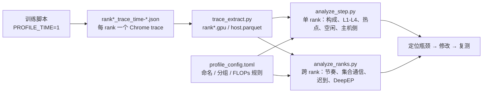
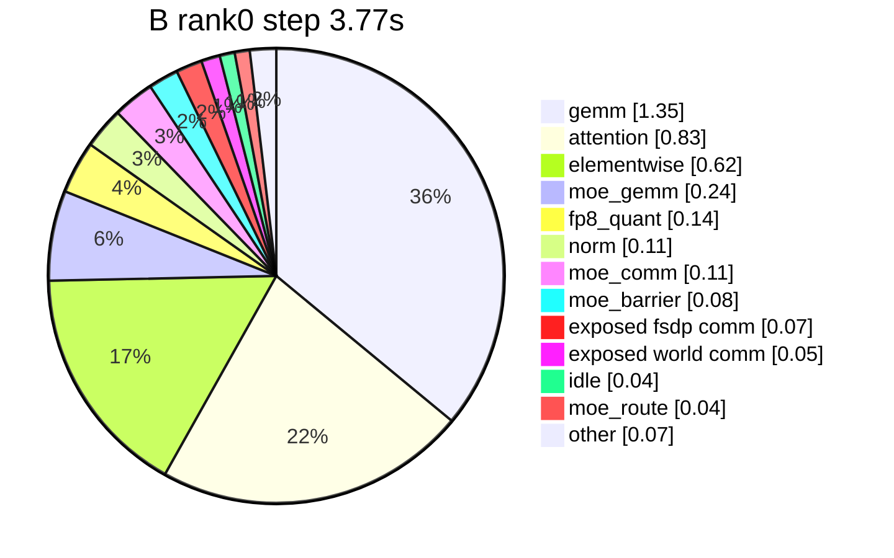
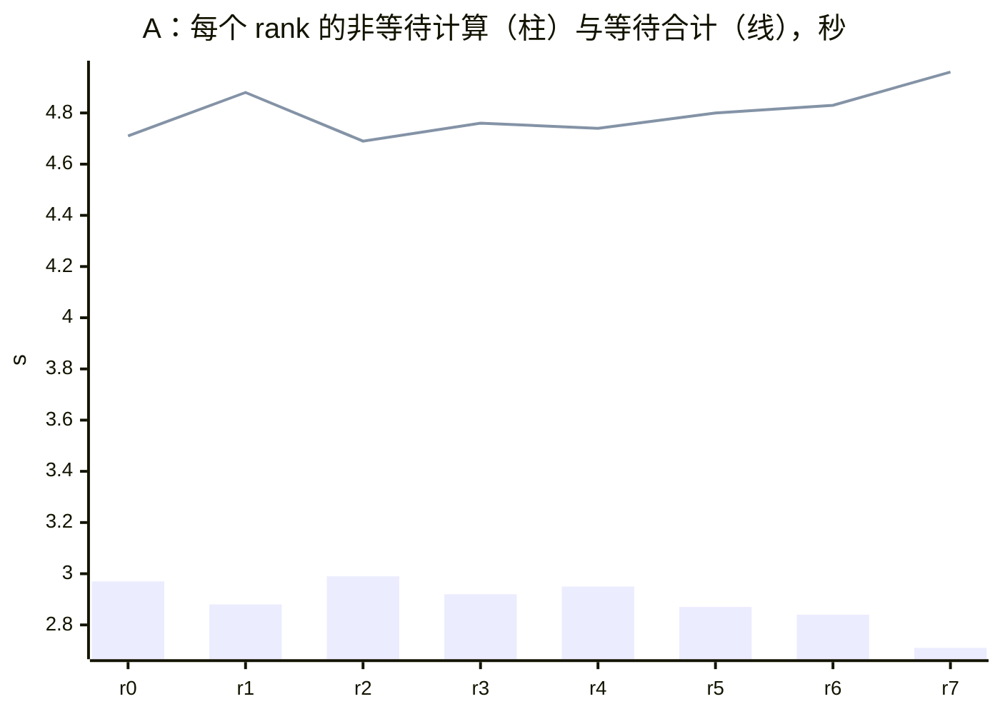
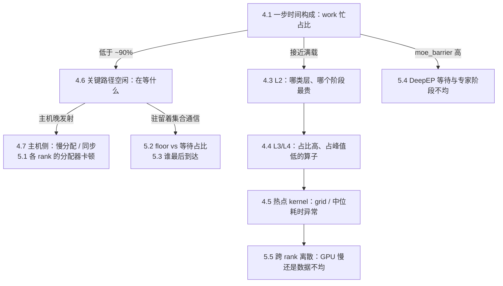

# XTuner 训练速度 profile 指南：以单机 8 卡 GLM-5.2-30B 为例

本文说明 `profile/` 下三个分析脚本的用法、每张表和图的含义，以及怎样从报告走到具体的优化动作。示例是单机 8 卡
GLM-5.2-30B（5 层：3 dense + 2 MoE，外加 1 层 MTP；层结构与 78 层的 GLM-5.2 相同），用同一套工具做了一次
“profile → 定位 → 修改 → 复测”。

结论：

1. **工具链是 3 个脚本加 1 个规则文件。** `trace_extract.py` 把每个 rank 的 Chrome trace 压成 parquet；
   `analyze_step.py` 看单个 rank，从 L1 训练阶段一路下钻到 L4 算子；`analyze_ranks.py` 做跨 rank 对比（谁拖慢了全局、
   集合通信是在传数据还是在等人、DeepEP 里有多少是等待）。算子命名、分组和 FLOPs 公式都在 `profile_config.toml` 里。
2. **示例 A（AdamW）：GPU 只有 `57.9%` 的时间在干活。** 显存触顶（reserved `~130GB`）使 8 个 rank 中 6 个出现
   `0.8–2.7s` 的分配器卡顿，且各自发生在不同时刻，其余 rank 就在 DeepEP 屏障和集合通信里等。rank0 最长的一段空闲 `2.0s`，
   正好对上 FSDP `post_backward_reduce` 里一次 `2.1s` 的 `aten::empty_strided`。
3. **示例 B（换成 Muon，其余不变）：reserved 降到 `115GB`，卡顿消失。** GPU 忙碌占比升到 `94.5%`，干净 step
   （Step 3、4、6）从 `5.0–9.8s` 降到 `3.5–4.2s`。
4. **B 已是计算瓶颈。** 主要耗时在稀疏注意力、GEMM、分块 loss 和优化器。其中两项与 512K 分析（`doc/sft_glm_512k_time.md`）
   的结论一致：TileLang 稀疏 MLA 前向偏慢；RMSNorm 反向的 dW 归约偏慢，是同一个 3D 输入问题。



## 1. 工具与层级

| 文件 | 输入 | 输出 | 回答的问题 |
|---|---|---|---|
| `profile/trace_extract.py` | `profiling_time/step-N/` | `rank{r}.gpu.parquet`、`rank{r}.host.parquet` | 把 1GB 级 JSON 压成可反复分析的表；每个 kernel 带上发射它的 CPU op、输入形状和 L1/L2 区间 |
| `profile/analyze_step.py` | parquet 目录、`--rank` | Markdown 报告，可选 `--html` 交互时间线 | 这一步的时间花在哪：哪个阶段、哪一层、哪个算子，GPU 什么时候在等、等什么 |
| `profile/analyze_ranks.py` | parquet 目录、`--ranks` | Markdown 报告 | 哪个 rank 拖慢了全局；集合通信是在传数据还是在等人；DeepEP 里有多少是等待 |
| `profile/profile_config.toml` | — | — | kernel → 算子（L4）→ 块（L3）的规则、FLOPs 公式、峰值算力、报告阈值 |

| 层级 | 来源 | 例子 |
|---|---|---|
| L1 训练阶段 | 训练循环里的 `xtuner.L1.*` 区间（主线程），以及 `Optimizer.step` | `forward.0`、`backward.0`、`clip`、`Optimizer.step#Muon.step` |
| L2 层与模块 | 模型里的 `xtuner.L2.*` 区间（发射线程） | `layer4.forward`、`layer4.recompute`、`layer4.backward`、`loss.chunk_forward`、`mtp1.forward` |
| L3 块 | 按规则把 L4 归类 | `attention`、`gemm`、`moe_gemm`、`moe_comm`、`moe_barrier`、`fp8_quant`、`norm`、`fsdp comm` |
| L4 算子 | 发射 kernel 的 CPU op（按 `External id` 关联），或按 kernel 名套规则 | `sparse_mla_bwd`、`fp8_gemm 16384x16384x6144`、`deepep dispatch`、`rmsnorm_bwd (inductor)` |

三个关联方式决定了数字可信：

- 每个 GPU kernel 通过 CUPTI `External id` 找到发射它的 CPU op，所以 `moe::gemm_fp8_fp8_bf16_nt` 的输入形状可以算出 FLOPs，
  `DeepEPCombine` 和 `DeepEPDispatchBackward` 也能区分开；
- L2 区间按发射线程查找：反向和重算的 kernel 由 autograd 线程发射，它们的 L2 区间也在那条线程上；
- L1 区间只在主线程上，所以按发射时刻去主线程查找，反向 kernel 也能落到 `backward.i`。

## 2. 采集

训练配置里打开 time profile，跳过编译步和显存预热，只采一步：

| 环境变量 | 本例 | 说明 |
|---|---|---|
| `PROFILE_TIME=1` | 1 | 打开 time profile |
| `PROFILE_STEP` / `PROFILE_TIME_STEP` | `4` | 从 0 计数：`4` 采的是日志里的 Step 5，trace 目录是 `profiling_time/step-4` |
| `PROFILE_RANKS` | `all` | 单机全采；多机建议采一个完整 EP 组（一个节点）加一个完整 FSDP 组，跨 rank 对比才有意义 |

本例的启动脚本是 `.scratch/guide_profile/launch_glm30b_profile.sh`，封装 `sft_glm_tiny.sh`：

```bash
export CONDA_ENV=pt29_glm2
export DISPATCHER=deepep EP_SIZE=4 SP_SIZE=2
export DATASET_TYPE=alpaca_long SAMPLE_MAX_LENGTH=8192 PACK_MAX_LENGTH=32768 GLOBAL_BATCH_SIZE=8   # 每个 DP rank 2 个 micro-batch
export SPARSE_MLA_BACKEND=cudnn_dsa INDEXER_BACKEND=cute_dsl
export TOTAL_STEP=6 PROFILE_TIME=1 PROFILE_STEP=4 PROFILE_RANKS=all
export OPTIMIZER=adamw                      # 示例 A；示例 B 为 OPTIMIZER=muon
export WORK_DIR=work_dirs/guide_profile_time_0923/glm30b_ep4_sp2_r2
bash sft_glm_tiny.sh                        # FP8、compile、activation offload 等沿用脚本默认值
```

| 运行 | 目录 | 各步墙钟（s） | reserved 峰值 |
|---|---|---|---:|
| A：AdamW | `work_dirs/guide_profile_time_0923/glm30b_ep4_sp2_r2/20260923164024` | Step 2–6：`5.50 / 5.01 / 7.17 / 12.18（采样） / 9.79` | `~130GB` |
| B：Muon | `work_dirs/guide_profile_time_0923/glm30b_ep4_sp2_muon/20260923165440` | Step 2–6：`5.54 / 3.53 / 3.70 / 10.04（采样） / 4.16` | `~115GB` |

两点注意：

- **采样步的墙钟包含 trace 导出，不能直接用。** 应该用 trace 里的 GPU 时间跨度（A `7.67s`、B `3.77s`）和相邻干净步比较。
  两者一致，这一步才有代表性。
- **L2 区间必须在 `torch.compile` 的编译区域之外，否则会被 Dynamo 丢掉。** 本次修正了 GLM-5.2 dense 层：编译目标从
  `GLM52DenseDecoderLayer.forward` 改成 `_glm52_forward`，dense 层的 forward/recompute 这才出现在 L2 里。其他模型的
  `DenseDecoderLayer.forward` 也整体编译，有同样的问题。报告里某类层缺少 forward/recompute 时，先查编译边界。

## 3. 抽取

```bash
python profile/trace_extract.py $RUN/profiling_time/step-4 .scratch/guide_profile/pq_muon     # 8 个 rank 并行
```

每个 rank 输出一行，例如 `rank0: 12209 GPU events, 4780 inside an L2 range`。512K/SP8 的一个 rank（1GB JSON，20 万个 kernel）
抽取约 `18s`，单 rank 报告约 `6s`。规则只在读 parquet 时生效，改 `profile_config.toml` 不需要重新抽取。

## 4. 单 rank：`analyze_step.py`

```bash
python profile/analyze_step.py .scratch/guide_profile/pq_muon --rank 0 --out step_rank0.md --html step_rank0.html
```

报告共 7 节。下面按“先判断 GPU 有没有在干活，再看它在干什么”的顺序，结合 A、B 两次运行解读。

### 4.1 一步时间构成

这是对 GPU 时间跨度的精确划分：有 work kernel（compute 或 DeepEP）在跑的时刻，记到该 kernel 的 L3 块；没有 work 时，
记到当时驻留的通信（`exposed ...`），否则记为 `idle`。各项之和等于跨度。

| 类别 | A：AdamW（7.674s） | B：Muon（3.769s） |
|---|---:|---:|
| work 忙（compute + DeepEP） | `4.446s`（57.9%） | `3.561s`（94.5%） |
| `idle` | `2.57s`（33.4%） | `0.04s`（1.2%） |
| `moe_barrier`（DeepEP notify，基本是等最慢的 EP rank） | `1.48s`（19.3%） | `0.08s`（2.2%） |
| `exposed fsdp comm` | `0.58s`（7.6%） | `0.07s`（1.7%） |
| `gemm` / `attention` / `elementwise` | `0.97 / 0.83 / 0.48s` | `1.35 / 0.83 / 0.62s` |

A 的 `idle + moe_barrier + exposed` 超过一半，先查等待（4.6、4.7 节和第 5 节）；B 已接近满载，看计算本身（4.2–4.5 节）。
B 的构成：



同一节还有“L3 块 × 阶段”表。B 的 `gemm` 有 `0.37s`、`elementwise` 有 `0.28s` 落在 `other` 列，即优化器阶段：
Muon 的 Newton-Schulz 迭代是 bf16 `bmm`。

### 4.2 L1 训练阶段

| L1 | 起点 s | 墙钟 s | work 忙 s | 忙占比 % |
|---|---:|---:|---:|---:|
| forward.0 | 0.050 | 0.660 | 0.638 | 96.7 |
| backward.0 | 0.709 | 0.843 | 0.811 | 96.2 |
| forward.1 | 1.552 | 0.656 | 0.634 | 96.7 |
| backward.1 | 2.208 | 0.847 | 0.825 | 97.4 |
| clip | 3.065 | 0.056 | 0.020 | 35.5 |
| Optimizer.step#Muon.step | 3.121 | 0.647 | 0.626 | 96.7 |

```mermaid
---
config:
  gantt:
    displayMode: compact
---
gantt
    title B rank0 L1（节选）
    dateFormat x
    axisFormat %S.%L
    section L1
    prepare_input 35.4ms : 0, 35
    fp8_scale 13.1ms : 35, 48
    forward.0 659.6ms : 49, 709
    backward.0 842.7ms : 709, 1551
    forward.1 656.0ms : 1551, 2207
    backward.1 846.9ms : 2207, 3054
    clip 55.9ms : 3064, 3120
    Optimizer.step Muon.step 647.5ms : 3121, 3768
```



读法：各阶段墙钟之和就是 step 的结构。忙占比低的阶段内部有暴露等待，例如 A 的 `backward.1` 只有 `45%`。本例的优化器占 `17%`，
这是 5 层小模型的比例；78 层的 512K 任务里，优化器约 `2s / 292s`。

### 4.3 L2 层与模块

| L2 | 实例 | 平均墙钟 ms | 平均 work 忙 ms | 合计墙钟 s | 占 step % |
|---|---:|---:|---:|---:|---:|
| loss · forward | 4 | 165.87 | 164.80 | 0.66 | 17.6 |
| dense layer · backward | 6 | 61.88 | 61.52 | 0.37 | 9.9 |
| moe layer · backward | 4 | 86.82 | 86.26 | 0.35 | 9.2 |
| dense layer · forward | 6 | 41.06 | 40.49 | 0.25 | 6.5 |
| moe layer · recompute | 4 | 58.99 | 58.54 | 0.24 | 6.3 |
| dense layer · recompute | 6 | 38.18 | 37.95 | 0.23 | 6.1 |
| moe layer · forward | 4 | 53.19 | 52.73 | 0.21 | 5.7 |
| mtp layer · backward | 2 | 96.71 | 96.19 | 0.19 | 5.1 |

- 墙钟 = 实例首个到末个 work kernel 的跨度；work 忙 = 这段时间里任何 work kernel 在跑的时间，包括其他线程同时发射的。
  例如分块 loss 在前向里就算 lm_head 的梯度 GEMM，这些 kernel 由 autograd 线程发射，不在 loss 区间内，但占着这段 GPU 时间。
- 嵌套的 L2（`mtp1` 包着 `layer6`）只算自身部分，各行墙钟可以相加。
- `loss · forward` 占 `17.6%`：每个 micro-batch 有主干和 MTP 两个 loss，lm_head 是 `2048 x 154880 x 6144` 的 bf16 GEMM，
  实测 `750–800 TFLOP/s`（峰值的 `76–81%`），已经很高效。这个占比同样是小模型的特点。

另一张表列出每层每实例的平均墙钟（ms），用来找异常慢的层：

| layer | kind | forward | recompute | backward |
|---:|---|---:|---:|---:|
| 1–3 | dense layer | 36.0–43.6 | 35.0–42.8 | 61.8–62.0 |
| 4 | moe layer | 57.8 | 62.0 | 86.9 |
| 5 | moe layer | 48.6 | 56.0 | 86.8 |
| 6 | mtp layer | 61.2 | 60.0 | 96.7 |

A 的同一张表里，`layer4` 的 backward 是 `709.6ms`，而 `layer5` 只有 `158.4ms`：前者几乎全是 `deepep cached_notify_combine`，
也就是在等别的 EP rank（见 5.4 节）。第一个 micro-batch 的 L2 甘特图（B，节选）：

```mermaid
---
config:
  gantt:
    displayMode: compact
---
gantt
    title B rank0 L2（第一个 micro-batch，节选）
    dateFormat x
    axisFormat %S.%L
    section forward
    layer1 dense 35.1ms : 4, 39
    layer2 dense 43.4ms : 40, 83
    layer3 dense 43.2ms : 83, 127
    layer4 moe 59.8ms : 128, 188
    layer5 moe 47.9ms : 189, 237
    loss 166.6ms : 238, 405
    layer6 mtp 64.6ms : 421, 486
    loss 164.5ms : 487, 651
    section recompute
    layer6 mtp 59.7ms : 663, 723
    layer5 moe 54.2ms : 879, 933
    layer4 moe 58.7ms : 1025, 1083
    layer3 dense 42.5ms : 1173, 1215
    section backward
    layer6 mtp 96.6ms : 724, 820
    layer5 moe 87.0ms : 933, 1020
    layer4 moe 85.8ms : 1083, 1169
    layer3 dense 62.1ms : 1215, 1277
```



层数多时（例如 78 层），同一阶段里相邻的同类层会合并成一根 `moe layer x75` 的柱子，图的大小不随层数增长。

### 4.4 L3/L4 层内算子

报告取合计墙钟最大的 3 个层组，给出每实例平均的 L3 表、L4 表和中位实例的甘特图。B 的 `moe layer · backward`（4 个实例）：

| L3 | 每实例 ms | 占比 % |
|---|---:|---:|
| attention | 26.79 | 31.0 |
| moe_gemm | 19.97 | 23.1 |
| gemm | 16.38 | 19.0 |
| norm | 5.96 | 6.9 |
| moe_comm | 5.74 | 6.7 |
| fp8_quant | 4.96 | 5.8 |
| moe_route | 2.13 | 2.5 |
| moe_barrier | 1.73 | 2.0 |

| L3 | L4 | GEMM MxNxK | 次/实例 | 每实例 ms | TFLOP/s | 占峰值 % |
|---|---|---|---:|---:|---:|---:|
| attention | sparse_mla_bwd |  | 3 | 25.42 | 465 | 47.0 |
| moe_gemm | fp8_grouped_gemm_dw | 137952x4096x6144 | 1 | 7.07 | 982 | 49.6 |
| moe_gemm | fp8_grouped_gemm | 129816x6144x4096 | 1 | 6.33 | 1,032 | 52.1 |
| norm | rmsnorm_bwd (inductor) |  | 9 | 5.96 |  |  |
| moe_comm | deepep dispatch |  | 1 | 3.39 |  |  |
| gemm | fp8_gemm | 16384x16384x6144 | 1 | 2.90 | 1,139 | 57.6 |
| gemm | aten::mm | 16384x6144x256 | 1 | 1.16 | 44 | 4.5 |

读法：

- **TFLOP/s 和占峰值**只对 `profile_config.toml` 能算 FLOPs 的算子给出，FLOPs 来自发射该 kernel 的 op 的输入形状。
  GEMM 行按（算子, N, K）聚合、M 取平均，所以路由 token 数不同的 grouped GEMM 合成一行，而 N、K 相同但 M 差 2 倍以上的分开列。
- **占峰值低、但占比高的行最值得看。** 这里是稀疏 MLA 反向（`47%`），以及 `rmsnorm_bwd (inductor)`：一个访存型算子每层用了
  `6ms`（见 4.5 节）。`aten::mm 16384x6144x256` 只有峰值的 `4.5%`，是 N=256 的 router 反向，形状太窄，绝对耗时也小，不值得优化。

中位实例（`layer5.backward`）的甘特图，每个 section 是一个 L3 块，每根柱子是连续的同一个 L4 算子：

```mermaid
---
config:
  gantt:
    displayMode: compact
---
gantt
    title B layer5.backward（墙钟 87.0ms，节选）
    dateFormat x
    axisFormat %S.%L
    section moe_comm
    deepep dispatch 3.4ms : 3, 6
    deepep combine 2.3ms : 36, 38
    section moe_route
    moe.unpermute_bwd 1.2ms : 6, 7
    moe.unpermute 0.9ms : 33, 34
    section moe_gemm
    fp8_grouped_gemm 3.0ms : 8, 11
    fp8_grouped_gemm_dw 3.5ms : 13, 16
    fp8_grouped_gemm 6.2ms : 19, 25
    fp8_grouped_gemm_dw 6.9ms : 26, 33
    section moe_barrier
    deepep cached_notify_combine 2.1ms : 34, 36
    section gemm
    aten.mm 2.1ms : 39, 41
    fp8_gemm 2.9ms : 44, 47
    fp8_gemm 2.8ms : 47, 50
    section norm
    rmsnorm_bwd (inductor) 2.9ms : 41, 44
    rmsnorm_bwd (inductor) 2.5ms : 84, 86
    section attention
    sparse_mla_bwd 25.7ms : 52, 78
    rope_cat (inductor) 0.9ms : 79, 80
```



图上能直接读出反向的顺序：先对 MoE 块做 combine 的反向（dispatch），经过专家 GEMM 的 dgrad/dW，再做 dispatch 的反向（combine），
然后是注意力反向。其中稀疏 MLA 反向一项占了近 30%。

### 4.5 热点 kernel

按 GPU 总时间排序的 kernel，带 L4、L3、次数、中位耗时和 launch grid。B 的前几行：

| kernel | L4 | 次数 | 合计 s | 中位 ms | 占 work % | grid |
|---|---|---:|---:|---:|---:|---|
| main_kernel | sparse_mla_fwd | 24 | 0.397 | 15.56 | 10.7 | [16384, 1, 1] |
| …sparse_attention_backward… | sparse_mla_bwd | 12 | 0.296 | 24.62 | 8.0 | [16384, 1, 1] |
| nvjet_tst_256x128_64x4_1x2_h_bz_coopA_NNT | aten::bmm | 198 | 0.275 | 0.45 | 7.4 | [2, 66, 1] |
| nvjet_tst_192x192_64x3_2x1_v_bz_coopB_NTN | aten::mm | 32 | 0.166 | 5.23 | 4.5 | [2, 66, 1] |

这张表最适合找“慢得不合理”的 kernel。本例里 RMSNorm 反向有两类 kernel：grid 为 `[16384]` 的 dx 部分中位 `0.18ms`；
grid 等于隐藏维 `[6144]` 的 dW 归约中位 `2.2ms`，是前者的 12 倍，因为每个 program 沿全部 token 做跨步读取。512K 分析里用单卡
微基准证实了这一点，对 3D 输入先展平成 2D 可以降到 `1/14`（`doc/sft_glm_512k_time.md` 3.1 节）。

### 4.6 关键路径空闲

work 并集之外的每一段空闲，都记到其后第一个 work kernel 上：它在哪个阶段、哪一层，空闲时驻留着什么通信，是否在等 FSDP 解分片
某个模块，以及这个 kernel 是否在空闲开始后才被 launch（即“主机晚发射”，说明原因在 CPU 侧）。A 的结果：

| 阶段 | 在等什么 | 秒 | 次数 | 其中主机晚发射次数 |
|---|---|---:|---:|---:|
| backward | mtp_block AG | 2.347 | 2 | 1 |
| backward | layerN.backward [nothing] | 0.201 | 4 | 4 |
| backward | no L2 [fsdp AG+fsdp RS+memcpy] | 0.137 | 1 | 0 |
| * | < 1 ms 的零碎空闲 | 0.053 | 6508 | 357 |

最长的几段空闲，以及同一时段最长的主机等待：

| 起点 s | 时长 ms | 阶段 | 在等什么 | 主机晚发射 | 同时段最长主机等待 |
|---:|---:|---|---|---|---|
| 3.224 | 2,014 | backward | mtp_block AG | 是 | aten::empty_strided 2129ms @ post_backward_reduce (mtp_block.layers.0) |
| 1.073 | 333 | backward | mtp_block AG | 否 | cudaStreamSynchronize 489ms @ loss.chunk_backward |

第一行就是诊断：GPU 空了 `2.0s`，下一个 kernel 发射晚了，同一时刻 CPU 卡在 FSDP 反向 reduce 的一次显存分配上。B 里这一节只剩
`0.2s`，最长一段 `31ms`，是 `clip` 阶段的一次 all-reduce。

### 4.7 主机侧等待

同步调用（`cudaStreamSynchronize` / `cudaDeviceSynchronize` / `.item()`）和慢分配（`aten::empty*` ≥ 5ms），按 L1、L2 和
FSDP 区间汇总。A：

| 主机事件 | L1 | L2 / FSDP | 次数 | 合计 s | 最长 ms |
|---|---|---|---:|---:|---:|
| aten::empty_strided | backward | - / post_backward_reduce (mtp_block.layers.0) | 1 | 2.129 | 2,129 |
| cudaStreamSynchronize | post_micro | - | 10 | 1.493 | 1,481 |
| cudaStreamSynchronize | forward | loss.chunk_forward | 36 | 0.594 | 20 |
| aten::_local_scalar_dense | forward | loss.chunk_forward | 32 | 0.563 | 20 |

读法：**主机等待只有在造成 GPU 空闲时才是问题。** 比如 `loss.chunk_forward` 里 32 次 `.item()`（每次最长 20ms），在 A、B 中
都存在，但 B 的空闲表里没有对应的空档：GPU 队列足够长，主机等的是 GPU，而不是 GPU 等主机。反过来，慢分配几乎一定会让 GPU 空下来，
因为触顶时分配器要先同步设备，再释放、重映射缓存。

## 5. 跨 rank：`analyze_ranks.py`

```bash
python profile/analyze_ranks.py .scratch/guide_profile/pq_muon --out ranks.md          # 默认分析目录里全部 rank
python profile/analyze_ranks.py $PQ --ranks 0-7 248 255                               # 也可指定 rank 或区间
```

### 5.1 每个 rank 的时间构成

同步训练由最慢的 rank 决定节奏，其余 rank 把差值表现为等待。A：

| rank | span s | work 忙 s | 其中 DeepEP 屏障 s | 非等待计算 s | 暴露通信 s | 空闲 s | 其中主机晚发射 s | 分配器卡顿 s |
|---:|---:|---:|---:|---:|---:|---:|---:|---:|
| 0 | 7.674 | 4.446 | 1.481 | 2.965 | 0.663 | 2.565 | 2.554 | 2.541 |
| 1 | 7.759 | 4.686 | 1.804 | 2.882 | 3.033 | 0.040 | 2.126 | 0.000 |
| 2 | 7.683 | 4.191 | 1.198 | 2.993 | 0.646 | 2.847 | 2.841 | 2.746 |
| 3 | 7.677 | 3.296 | 0.380 | 2.916 | 2.741 | 1.640 | 3.485 | 0.789 |
| 4 | 7.695 | 4.768 | 1.816 | 2.953 | 1.200 | 1.726 | 2.648 | 1.906 |
| 5 | 7.670 | 5.175 | 2.300 | 2.875 | 2.456 | 0.040 | 2.125 | 0.000 |
| 6 | 7.673 | 4.195 | 1.355 | 2.840 | 0.606 | 2.871 | 3.004 | 2.509 |
| 7 | 7.672 | 3.494 | 0.786 | 2.708 | 2.371 | 1.807 | 3.666 | 0.944 |



各 rank 的非等待计算只有 `2.7–3.0s`，但每个 rank 都等了 `4.7–5.0s`。分配器卡顿分散在 6 个 rank 上，每个 rank 卡的时刻不同，
轮流拖住其他 rank。没有分配器卡顿的 rank1、rank5 仍有 `2.1s` 的主机晚发射，因为它们的主机在同步调用里等那些卡住的 rank。
B 中每个 rank 的等待降到 `0.22–0.52s`，分配器卡顿除 rank0 的 `0.04s` 外全部为 0。

### 5.2 集合通信：线速与等待

NCCL kernel 按（进程组 集合通信, dtype, 字节数）分组。floor = 最快一次，近似线速；等待占比 = `1 - 次数 x floor / 驻留`。B 节选：

| 集合通信 | dtype | GB | 次/rank | 驻留 s/rank | floor ms | p50 ms | floor GB/s | 等待占比 % |
|---|---|---:|---:|---:|---:|---:|---:|---:|
| fsdp RS | BFloat16 | 5.24 | 4 | 0.05 | 9.46 | 11.21 | 554 | 29.5 |
| fsdp AG | BFloat16 | 1.90 | 10 | 0.04 | 3.06 | 3.36 | 621 | 28.3 |
| world AR | Float | 0.00 | 12 | 0.05 | 0.01 | 1.97 | — | 99.7 |

读法：floor 带宽正常（机内 NVLink `550–620 GB/s`）而等待占比高，说明是在等其他 rank，不是链路慢。`world AR` 这类很小的
all-reduce 几乎全是等待，它们就是全局屏障。512K 多机时，同一张表显示 FSDP floor 约 `49 GB/s`、p50 远大于 floor，
结论同样是“迟到，不是带宽”。

### 5.3 屏障迟到

同一进程组的集合通信在各 rank 上按签名配对（某个 rank 丢了一条记录也不会错位），用结束时刻对齐时钟（集合通信在各 rank 上同时结束），
迟到 = 最后到达 - 中位到达：

| 进程组 | A：迟到 p90 ms | B：迟到 p90 ms | A：最常最后到达的 rank（占比） |
|---|---:|---:|---|
| fsdp | 33.3 | 2.0 | 2 (17%), 0 (13%), 3 (13%) |
| sp | 6.4 | 1.7 | 6 (18%), 0 (17%), 4 (16%) |
| world | 6.6 | 5.4 | 2 (29%), 5 (29%), 0 (14%) |

最后到达的 rank 分布很散，说明是轮换的掉队者（各 rank 轮流卡顿），而不是某个固定的坏 rank。如果某个 rank 占比远高于 1/组大小，就查它。

### 5.4 DeepEP：自身耗时与等待

同一 EP 组内（EP 大小从 `notify_dispatch<N>` 模板参数读出，组是连续 rank）按调用顺序对齐 DeepEP kernel。最快 rank 的耗时
近似 kernel 自身代价，其余是等待：

| EP 组 | kernel | A：等待 s/rank | B：等待 s/rank | 自身耗时 s（A、B 相同） |
|---|---|---:|---:|---:|
| 0-3 | cached_notify_combine | 1.083 | 0.061 | 0.001 |
| 4-7 | cached_notify_combine | 1.412 | 0.073 | 0.002 |
| 0-3 | dispatch / combine | 0.001 / 0.001 | 0.001 / 0.001 | 0.06 / 0.045 |

| EP 组 | 专家阶段最慢/平均 p50 | p90 | corr(专家耗时, 等待) |
|---|---:|---:|---:|
| A 0-3 / 4-7 | 1.43 / 1.33 | 1.86 / 2.96 | -0.999 / -1.000 |
| B 0-3 / 4-7 | 1.05 / 1.20 | 1.44 / 1.42 | -0.996 / -0.999 |

corr 接近 -1，说明 combine 屏障的等待完全由“dispatch 结束到 combine 开始”这段专家阶段的耗时差造成。耗时差可能来自路由不均，
也可能来自这段时间里某个 rank 的主机卡顿（A 属于后者）。512K 任务里同样的方法测出 DeepEP `40.8s` 中有 `10.8s` 是等待。

### 5.5 同名 kernel 的跨 rank 耗时

每个 rank 上调用次数相同的最重 compute kernel，比较各 rank 的中位耗时。B 节选：

| kernel | r0 ms | r5 ms | r6 ms | r7 ms | 离散度 % |
|---|---:|---:|---:|---:|---:|
| sparse_mla_fwd | 15.56 | 15.26 | 15.04 | 14.87 | 5.1 |
| sparse_mla_bwd | 24.62 | 22.99 | 17.27 | 12.08 | 63.9 |
| fp8_gemm（6144x16384） | 2.75 | 2.77 | 2.70 | 2.67 | 3.7 |

GEMM 的离散度只有 `3–4%`，说明各 GPU 本身一样快；稀疏 MLA 反向离散 `64%`，是数据不均。这一步 rank7 只有 `14,566` 个有效 token，
rank6 `22,609`，其余 rank `29K–33K`。如果某个 rank 在所有 kernel 上都慢，那是 GPU 本身的问题（降频、坏卡）。

## 6. 从报告到优化

读报告的顺序：



本例的结论与动作：

| 发现 | 证据 | 动作 | 结果 / 预期 |
|---|---|---|---|
| A：显存触顶，分配器卡顿轮流拖慢全局 | 4.6 节 `2.0s` 空闲对上 `2.1s` 的 `aten::empty_strided`；5.1 节 6 个 rank 有卡顿；reserved `~130GB` | 降低显存：本例换 Muon（优化器状态减半）；也可以 `SWAP_OPTIMIZER=1`、减小 pack，或按 512K 的 P0-c 去掉 `record_stream` 留下的 pending 块 | **已验证**：reserved `115GB`，GPU 忙碌占比 `57.9% → 94.5%`，干净 step（Step 3、4、6）`5.0–9.8s → 3.5–4.2s` |
| B：稀疏 MLA 前向是单个最大的 kernel | 4.5 节 `sparse_mla_fwd` 占 work `10.7%`；TileLang 实现 | 换 FlashMLA 前向（512K 微基准 `1.58x`） | 本例约省 `0.14s/步`（`~4%`） |
| B：RMSNorm 反向 dW 归约慢 | 4.5 节 grid `[6144]` 的 kernel `2.2ms`，dx 部分 `0.18ms` | `F.rms_norm` 前把输入展平成 2D | 本例约省 `0.04s/步`；512K 约 `10s/步` |
| B：优化器占 `17%` | 4.2 节 `Muon.step` `0.65s`，其中 `bmm` `0.37s` | 小模型的比例，不需要为 512K 处理 | — |
| B：分块 loss 占 `17.6%` | 4.3 节 `loss · forward`，lm_head GEMM 已达峰值 `76–81%` | 算子已经高效，这是词表大小决定的，不用动 | — |
| A、B：数据不均 | 5.5 节 `sparse_mla_bwd` 离散 `64%`，rank7 token 数只有一半 | 打包时按 token 数均衡；多机长序列下影响更大 | — |

## 7. 规则文件 `profile_config.toml`

| 段 | 作用 | 例子 |
|---|---|---|
| `[device]` | 峰值算力，用于“占峰值” | `peak_tflops = { bf16 = 989.0, fp8 = 1979.0 }` |
| `[resource]` | kernel 名 → compute / deepep / nccl / memcpy | `deepep = 'deep_ep::'` |
| `[comm]` | NCCL 进程组描述 → 短名，集合通信 → 动词 | `"mesh_default.fsdp" = "fsdp"`，`"_allgather_base" = "AG"` |
| `[l4]` | 匹配 `"<op>|<kernel>"` → 算子名，可引用正则分组 | `{ match = 'deep_ep::(?:intranode::)?(\w+)', label = "deepep {1}" }` |
| `[l3]` | 匹配 `"<l4>|<op>|<kernel>"` → 块，按顺序第一个命中 | `{ match = '^deepep \w*notify', block = "moe_barrier" }` |
| `[flops]` | op 名 → FLOPs，`d` 是该 op 的输入形状列表 | `{ op = '^moe::gemm_fp8_fp8_bf16_nt$', mnk = "d[0][0][0], d[1][0][0], d[0][0][1]", dtype = "fp8" }` |
| `[report]` | 表格行数与阈值 | `gap_min_ms = 1.0`，`host_stall_ms = 5.0`，`l3_groups = 3` |

扩展时的规则：

- **新算子没有归类**：先看报告里它的 L4（默认就是 op 名，比如 `moe::permute`），再在 `[l3]` 加一条；规则按顺序匹配，
  更具体的放前面。例如 permute kernel 的名字里有 `grouped_gemm::`，所以 `moe_route` 要排在 `moe_gemm` 之前。
- **想看新算子的 TFLOP/s**：在 `[flops]` 按它的 `Input Dims` 写一条。报告里看不到输入形状时，trace 里该 op 的
  `args["Input Dims"]` 就是 `d`。
- 改完规则直接重跑 `analyze_*.py`，不需要重新抽取。

## 8. 注意事项

- **只采一步。** 结论要和相邻干净步的墙钟对照；采样步本身的墙钟包含 trace 导出。
- **主机晚发射的判据**是下一个 work kernel 的 launch 时刻晚于空闲开始后空闲长度的一半，只对 ≥ `gap_min_ms` 的空档统计。
- **`moe_barrier` 在单 rank 报告里是近似值**（notify kernel 的全部时长）；精确的等待拆分看 `analyze_ranks.py` 第 4 节，
  它需要整个 EP 组的 trace。
- **FLOPs 公式写在规则文件里**：注意力的公式假设 GLM 的 MLA 形状（`d_qk=576`、`d_v=512`），换模型需要改。
- **时钟对齐用集合通信的结束时刻**：同机多 rank 的时钟本来就一致，跨机也只差亚毫秒，对齐之后的到达时刻可以直接比较。

## 9. 总结

新的工具链用一次抽取、两份报告回答了速度分析的主要问题。`analyze_step.py` 说明单个 rank 的时间怎样从 L1 分到 L4、GPU 在等什么；
`analyze_ranks.py` 说明谁拖慢了全局、等待来自哪里。本例中 A 的报告指向显存触顶引起的分配器卡顿；换成 Muon 后，复测显示 GPU 忙碌
占比从 `57.9%` 升到 `94.5%`，step 时间减半。此后的瓶颈转为计算，L3/L4 表和热点 kernel 表给出的优化点，与 512K 分析得出的
FlashMLA 前向和 RMSNorm 2D 两项一致。

完整报告可以用下面的命令复现（输出在 `.scratch/guide_profile/`）：

```bash
for v in r2 muon; do
  python profile/analyze_step.py .scratch/guide_profile/pq_$v --rank 0 --out .scratch/guide_profile/step_${v}_rank0.md \
      --html .scratch/guide_profile/step_${v}_rank0.html
  python profile/analyze_ranks.py .scratch/guide_profile/pq_$v --out .scratch/guide_profile/ranks_${v}.md
done
```
