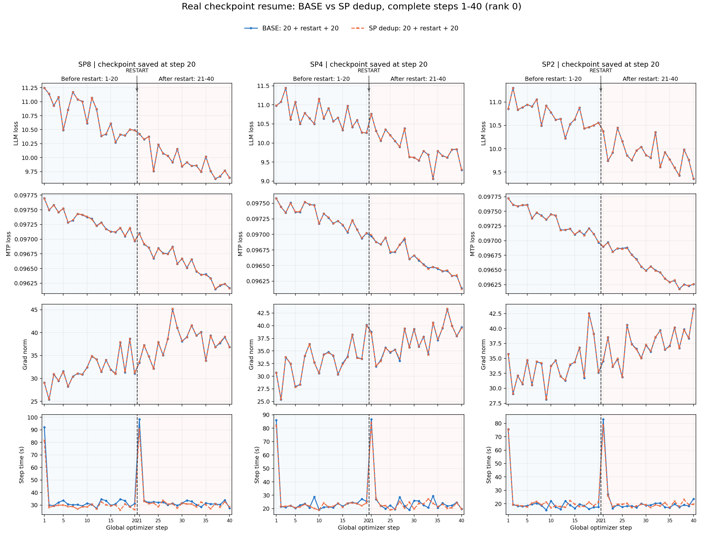
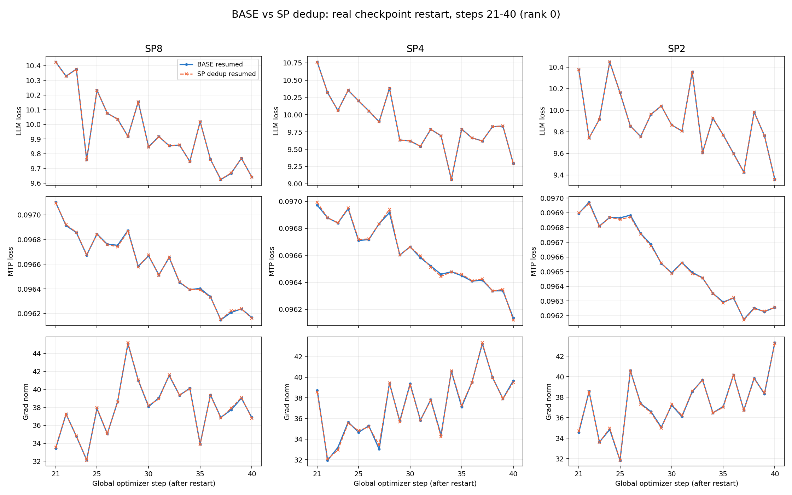
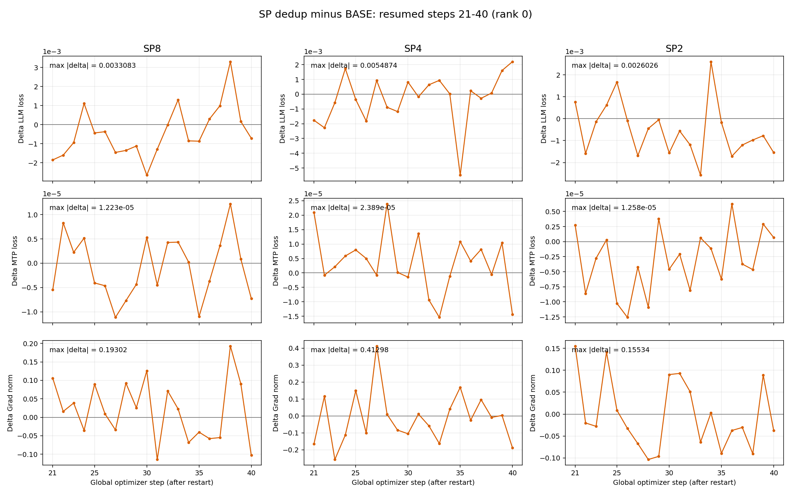

# SP leader-only full-batch broadcast validation

B-host experiment on 8 H200 GPUs, PyTorch 2.9.1+cu128, a five-layer GLM-5.3-Flash-25B configuration, EP4, FP8, frozen vision/projector, four loader workers. These are short-run comparisons, not a claim of bitwise equality or general performance guarantees.

| SP | DP | Global batch | Pack / maximum length |
| --- | --- | --- | --- |
| 8 | 1 | 1 | 524288 |
| 4 | 2 | 2 | 262144 |
| 2 | 4 | 4 | 131072 |

Each setting has BASE-C and SP-C uninterrupted 40-step trajectories, plus BASE-R and SP-R trajectories that save a complete native training checkpoint at step 20, exit, and start a new torchrun process to resume steps 21–40. All trajectories use a 40-step scheduling horizon and save at steps 20 and 40. R1 CSVs contain steps 1–20; R2 CSVs contain steps 21–40. Raw per-rank metric tables and pairwise rank-0 differences are included here; no training samples, credentials or full logs are published.

## Accuracy and real restart

The curves show close loss/gradient trajectories. The user accepted the observed numerical differences after reviewing the full 20+20 plots. This does not imply identical RNG state or bitwise reproducibility. SP4's resumed BASE/SP comparison has maximum absolute LLM-loss difference 0.0054874 and gradient-norm difference 0.4129829; those exceed the observed single BASE pair (0.0031843 / 0.2219009 for BASE resume-vs-continuous), so they must not be described as all differences falling inside a proven BASE noise bound.

## Performance

Rank-0 step-time medians, seconds. First-half window is steps 6–20; resumed window is 26–40. Checkpoint writes occur outside the reported training-step timer, so these figures do not measure full job wall time.

| SP | Continuous BASE / SP | R1 BASE / SP | Resumed BASE / SP |
| --- | --- | --- | --- |
| 8 | 31.0893 / 29.0898 | 30.6092 / 28.7591 | 30.9334 / 30.8747 |
| 4 | 22.5519 / 21.6727 | 23.6399 / 22.2205 | 22.4020 / 23.3114 |
| 2 | 18.6535 / 18.2997 | 18.5048 / 19.1784 | 18.7329 / 19.0853 |

SP8 first-half medians improve about 6%; its resumed segment is essentially level. SP4 resumed median is about 4.1% slower, although its mean is lower. SP2 R1 median is about 3.6% slower. These short samples show mixed windows rather than a proven uniform speedup or a stable regression. No scatter or GPU-residency optimization was introduced.

The original report gives SP8 total 20+20 wall time as BASE 29.2 min vs SP 32.6 min. A separate continuous-SP wall-time figure includes failed-attempt startup and must not be interpreted as successful-run throughput. Allocation failures/retries complicate end-to-end comparisons.

## Memory and scope

Whole-process-tree steady PSS from equal-length R1 runs: SP8 399.7→278.2 GiB (~30% lower), SP4 340.1→197.9 GiB (~42% lower), SP2 189.5→164.6 GiB (~13% lower). PSS varies over time; these are the report's selected steady-state summaries, not guaranteed bounds. The existing sampler selects torchrun/sft.py/run_case processes broadly rather than pinning one launcher PID, so unrelated-process exclusion is not independently guaranteed. The time-series plots are provided for inspection. GPU peaks were around 143,400 MiB in both arms, close to the H200 physical limit; initialization/peak CPU residency is not eliminated.

SP8 encountered OOMs. Both resumed arms use an experiment-side one-time torch.cuda.empty_cache() after the first resumed backward and before clipping, to release unused reserved allocations. This hook is not in the production patch and does not modify live tensor values. Its BASE no-hook comparison is included as CSV. OOM attempts were retried; failed run directories were removed by the experiment launcher, so successful trajectories alone do not establish robustness at this memory margin.

OSS input was not exercised. BASE does not checkpoint all training RNG state. These results do not validate TP>1.

## Individual plots

| SP | Loss | Gradient norm | Step time | CPU memory |
| --- | --- | --- | --- | --- |
| 8 | [loss](fig1_loss.png) | [grad](fig2_grad_norm.png) | [time](fig3_step_time.png) | [memory](fig4_memory.png) |
| 4 | [loss](fig1_loss_sp4.png) | [grad](fig2_grad_norm_sp4.png) | [time](fig3_step_time_sp4.png) | [memory](fig4_memory_sp4.png) |
| 2 | [loss](fig1_loss_sp2.png) | [grad](fig2_grad_norm_sp2.png) | [time](fig3_step_time_sp2.png) | [memory](fig4_memory_sp2.png) |

## Provenance

The GPU experiment used frozen BASE b75e11e43489f85ec29bb2b0c2728707ec0adc8d plus its retained local recipe changes and the reviewed SP patch. Follow-up edits to the three production files added bilingual comments and extracted the duplicate iterator-seed predicate. The bilingual increment was AST-identical to the CC readability revision. The PR ports that feature onto current upstream main; GPU results belong to the experiment snapshot, while CPU checks are rerun on the actual PR tree. Experiment-only allocator/stop hooks and launchers are not production changes.
