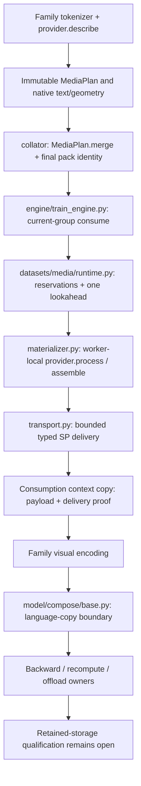

# Unified media pipeline

Opt-in common media processing for native family tokenizers and models. Disabled
by default; configuration and scoped reservations do not establish complete
physical-storage release or numerical/performance qualification.

## What is shared

The common implementation owns descriptors, bounded CPU scheduling, current-group
consumption, sequence-parallel (SP) delivery, and one-batch CPU lookahead. Providers
own native media processing semantics. Token expansion, image grids, MRoPE, visual
encoding, feature splicing, and modality layout remain model-family responsibilities.
The runtime contains no GLM/Qwen dispatch. A new provider does not automatically
make an arbitrary tokenizer or model compatible.

This is a source diagram, not a rendered or runtime-validated figure:



All `datasets/`, `engine/`, and `model/` paths in the diagram are under `xtuner/v1/`.

## Default-off and configuration

The public entry is `TrainerConfig.media_pipeline`, not a second model-forward
scheduler. Trainer/dataloader construction forwards the validated configuration to
participating tokenizer configurations and collators. A tokenizer must explicitly
advertise `supports_media_pipeline`; a collator must accept `media_pipeline`.
Pass the configuration as `media_pipeline` on the existing
`xtuner.v1.train.trainer.TrainerConfig`; do not configure independent copies in
each model forward.

```python
from xtuner.v1.datasets.media.config import MediaPipelineConfig

native_media = MediaPipelineConfig()
```

The default is `enabled=False`, eager/local processing, one decode thread, and no
lookahead. Disabled tokenizers retain their native paths; the collator adds no pack
identity, and the engine creates no media runtime. Nondefault media features while
disabled are configuration errors, not silently enabled optimizations. The generic
language boundary does not strip payload from ordinary contexts without a delivery
proof. Default-off equivalence still requires its paired regression evidence.

The following builds a **candidate configuration only**. It neither launches
training nor supplies resource or lifetime qualification:

```python
def candidate_media_config(certificates_path: str, *, host_budget: int, transport_budget: int):
    return MediaPipelineConfig(
        enabled=True,
        materialization="lazy",
        per_image=True,
        decode_threads=2,
        distribution="sp_leader",
        prefetch_batches=1,
        max_inflight_bytes=host_budget,
        max_pending_tasks=2,
        max_transport_bytes=transport_budget,
        source_manifest=certificates_path,
        unsupported_policy="error",
    )
```

Budgets must come from reviewed, full-process-tree admission, not from this example.
Configuration validation requires positive explicit byte/task limits when enabled,
`max_pending_tasks >= decode_threads`, and `1 <= decode_threads <= 16`.
SP-leader delivery and prefetch require lazy materialization; SP-leader delivery
also requires an explicit per-rank transport limit. Prefetch is only `0` or `1`.
Lazy materialization requires a nonempty `source_manifest`. That string alone is
**not** certificate validation or a production-qualification gate.
All byte limits are bytes, not element counts. The default schema caps are 32
tensor fields, rank 8 and 65,536 header bytes. Materialization and shutdown defaults
are 120 and 30 seconds respectively; these bound runtime waiting, not native-call
preemption or the launcher's process-group failure timeout.

`source_manifest` is the built-in provider's **image certificate manifest**, with
schema version 1 and per-source frozen geometry, immutable revision/content hash,
byte size, successful native decode/eligibility, and exact processor profiles. It
is not interchangeable with a source-collection manifest, a native pack manifest,
or a sampler file. Built-in provider construction verifies the certificate file
fingerprint; source/profile validation occurs when describing and processing.
Tests may use synthetic fixtures, but `fixture-manifest` is not a real certificate.
Built-in optimized eager/per-image processing also needs certificates unless an
explicitly supported native-eager fallback is selected.

## Prepare and cache image metadata

The production library entry `prepare_image_manifest` generates the input consumed
by `source_manifest`; it does not require session scripts, frozen trainer snapshots,
pack manifests, model weights, or evidence tools. Supply the exact image processor
used by the tokenizer, including the same pixel/token overrides, and the local
paths after native media-root resolution:

```python
from transformers import AutoProcessor
from xtuner.v1.datasets.media import prepare_image_manifest

processor = AutoProcessor.from_pretrained(model_path, local_files_only=True).image_processor
manifest = prepare_image_manifest(
    image_paths,
    provider="qwen_image",
    processor=processor,
    cache_dir=metadata_cache_dir,
    max_source_bytes=max_compressed_image_bytes,
    max_inflight_bytes=single_image_preparation_budget,
)
media = candidate_media_config(
    str(manifest), host_budget=runtime_host_budget, transport_budget=transport_budget
)
```

Preparation is sequential and supports the existing `glm_image` and `qwen_image`
local image paths with compact CPU float32 pixels and int64 grids. It performs a
bounded same-descriptor regular-file read and hashes actual bytes. A cache miss
admits header/decode and native patch-count/output reservations before native
RGB/EXIF decoding and the same provider-specific processor call. Exact geometry,
grid, shape, dtype and reservation checks must succeed before verified metadata
is stored. Reservations are conservative estimates, not a physical-memory proof
or a way to preempt an uncooperative native call. These are single-image preparation
limits; runtime current/lookahead/assembly budgets still apply independently.

Persistent `entries/` files contain metadata only, keyed by source content and size,
processor identity/configuration/library version and provider/cache version. Every
call rereads and hashes source bytes; a valid hit does not decode, predict patches
or process pixels again. Metadata checksums and schema are checked before reuse.
Writes use private temporary files and atomic replacement. Bad or changed cached
metadata is an error, not an implicit success or silent cache repair. On failure,
earlier valid entries remain reusable, but no partial final manifest is published.

The returned content-named manifest keeps the complete input URI sequence, including
duplicates, in `source_order`. Its `sources` table has one entry per URI in first-use
order, as required by the existing provider lookup. This is not dataset filtering:
tokenizer/plan occurrences remain in their original order, including repetitions.
One URI changing content during a preparation call fails explicitly.

URI/OSS reads, video, arbitrary new providers and other output formats are not
implemented by this preparation entry; they remain product extensions, not removed
goals. Errors and unsupported sources are not skipped or marked verified. An
explicit native-eager fallback is still separate from optimized preparation.
Adding a provider still requires its actual metadata/processing semantics and
tokenizer/collator integration, not a guessed resize formula. The preparation
entry does not change existing training, runtime, sampling, or cache-key behavior.

## Candidate support matrix

Here, **implemented** means a code path exists at the documented SHA, not that it
is qualified to run the target workload.

| Input or feature | Implemented candidate | Boundary / qualification |
| --- | --- | --- |
| GLM-5.3-Flash images | `glm_image`, `Glm53VLTokenizeFnConfig`, GLM collator | Frozen image/processor certificates required; real pixels/training unqualified |
| Qwen3-VL images | `qwen_image`, `Qwen3VLTokenizeFnConfig`, Qwen collator | Preserve native processor, token expansion and MRoPE; unqualified |
| Qwen3.5 images | Same Qwen provider/tokenizer/collator path | Preserve Qwen3.5 template/token-ID and model differences; unqualified |
| Local image source I/O | One same-FD regular-file/size check and bounded read of certified bytes plus one; hash before decoder import | Synthetic call-order tests only; real decoder/native pixel equivalence pending |
| OSS / URI image source I/O | Optimization rejected before plan creation; explicit eager policy returns the whole record to untouched native handling | No qualified bounded/version-bound native backend reader; optimized OSS is unsupported, not accepted scope |
| Text-only / no plan | Fixed EMPTY transport participation | No provider CPU work; not permission to skip SP control collectives |
| Video | Native eager path only, with explicit `unsupported_policy="eager"` | No optimized video provider; no lazy/SP/async video guarantee |
| Planned and native media in one pack | Error by default; explicit eager policy resolves plans before collation | Native/eager retained storage needs separate aggregate admission; not bounded-runtime qualification |
| Native unsupported image/video combinations | No extension of native support | Do not reinterpret mixed records as supported because transport accepts named tensors |
| New family or modality | Provider protocol is extensible | Requires tokenizer/collator/context glue, exact metadata and independent qualification |
| SP delivery | Typed R1, actual SP leader, transient per-rank GPU transport | Raw pixels return to native CPU placement before model consumption; real topology and memory evidence remain required |
| Async | One pending batch / one group, CPU-only orchestration | No cross-epoch speculative cursor commit; physical overlap qualification pending |
| Offload / recompute / external aliases | Existing training mechanisms plus partial language-copy mitigation | Retained-storage qualification open; frozen vision or disabled offload is not sufficient |

The frozen main already includes GLM per-image processing (#2199). Do not attribute
the historical pre-#2199 memory savings to this candidate. The opt-in per-image path must preserve existing native behavior; it is not a
new GLM per-image gain.
Required baseline compatibility fixes must be frozen and applied identically to
paired controls, while preserving raw main as a separate reference.

## Provider onboarding

### 1. Freeze semantics before scheduling

Determine whether native processing is independent per image or batch-dependent.
Freeze the actual processor class/module, configuration, package version, source
identity, effective EXIF-adjusted geometry, decode eligibility, token expansion,
grid layout, and any order/frame/crop decisions. Do not infer metadata from a generic
resize formula or another family's processor. Built-in providers reconstruct and
verify their frozen processor identity; an extension must supply an equivalent
contract. Certificates must be produced and checked using the real native path by
the authorized experiment owner, not by marking guessed metadata as verified.

### 2. Implement the existing protocol

`xtuner/v1/datasets/media/provider.py` defines `MediaProvider`:

| Member | Required behavior |
| --- | --- |
| `version: str` | Freeze the implementation version into every plan; materializer rejects a version mismatch |
| `capabilities: ProviderCapabilities` | Truthfully declare metadata exactness, independent images, worker-local/thread-safe behavior and modalities |
| `describe(sources, *, occurrence_id, per_image, source_manifest_fingerprint, decisions_json="{}") -> MediaPlan` | Produce exact, data-only ordered descriptors; no decode or live processor/tensor inside the plan |
| `process(entry: MediaEntry) -> MaterializedMedia` | CPU-only native processing of one semantic unit; close decoded originals and release temporaries on success/error |
| `assemble(plan, ordered_results) -> MaterializedMedia` | Preserve semantic occurrence order and native concat/layout; its copies and scratch must be budgeted |

Packing uses the data-only `MediaPlan.merge(plans)` operation, not a provider
method. It checks provider/version/configuration/manifest identities and ordered
axis-zero output schemas without creating a provider or reading source files.

Capabilities default conservatively. Lazy processing requires `metadata_exact`;
per-image processing requires `independent_images`. Worker-local instances are
preferred; otherwise thread safety must be certified. Capability flags describe a
contract, not a sandbox: providers must not import a distributed scheduler, submit
nested work into the same executor, or move data to CUDA.

The factory receives a serialized JSON **object**, not a live processor or arbitrary
Python dictionary. Registration can use an importable factory path:

```python
from xtuner.v1.datasets.media.provider import register_provider

register_provider("project_images", "my_project.media:make_provider")
```

`make_provider(processor_config_json: str)` must return the protocol implementation.
Registration names are unique. Only built-in registration is automatically imported
by `create_provider`; an external integration must load its registration in each
process that describes or materializes plans. Do not rely on another process's
registry or place family-name dispatch into materializer/runtime/transport.
The materializer caches an instance in executor-thread-local state keyed by the
frozen provider/config identity; processor/client/manifest residency is real memory
and needs separate accounting outside tensor reservations.

### 3. Respect the serialized and tensor boundaries

| Object / field | Semantics |
| --- | --- |
| `MediaSource` | URI plus immutable revision, effective width/height/orientation, byte size, optional content SHA256, JSON metadata; built-in image providers require hash and positive size |
| `MediaEntry` | Semantic occurrence ID, source tuple, exact output `TensorSpec` tuple, conservative `estimated_peak_bytes`, JSON metadata |
| `TensorSpec` | Native field name, supported dtype string, nonnegative shape tuple, concat dimension; dtype determines declared byte count |
| `MediaPlan` | Frozen provider/version, processor JSON/fingerprint, source-manifest fingerprint, ordered entries, final output specs, sample IDs and decisions JSON; protocol version is 1 |
| `MaterializedMedia` | Mutable runtime result: named tensors, JSON-compatible metrics/metadata; never stored inside a plan |
| `SequenceContext.media_plan` | Unresolved descriptor retained on the original batch; cannot be forwarded directly to the compose model |
| `media_pack_id` | Final collator semantic identity, separate from the plan fingerprint and delivery proof |
| `MediaDeliveryProof` | Engine-owned consumption ID, plan fingerprint and specs; shape/dtype delivery evidence, not pixel-equivalence or physical-lifetime proof |

Built-in image providers emit compact `MediaSource` descriptors with empty JSON
metadata. Full certificates stay in each provider's frozen manifest. Source facts
must match that manifest, and actual bytes, geometry and native processor outputs
remain verified. Older descriptors embedding a full certificate are accepted only
when that copy exactly matches the frozen manifest. New descriptors have different
fingerprints; regenerating plans is necessary to replace legacy cached descriptors.
Older implementations cannot execute the compact representation; keep all SP ranks
on the same source version and descriptor representation.

Plans contain JSON/scalars/tuples, never Tensor/PIL/Future/executor/client/CUDA state.
Provider output field names must map to actual native `SequenceContext` fields;
schema extensibility is not automatic model support. Output must have exactly the
declared names, shapes and dtypes: contiguous strided CPU tensors without autograd,
with compact backing storage. A tiny view retaining an oversized allocation is
rejected. Bound metadata as well as payload; declaring only logical tensor bytes
does not make a larger backing allocation safe.

### 4. Connect tokenizer, collator and model semantics

The tokenizer must return native text/labels/grid/position metadata plus a retained
plan for lazy images, not a preprocessed tensor hidden in the descriptor. Cache
identity and native pack/sampler manifests must bind the exact processor/tokenizer
and native no-truncation decisions. Preserve special-token IDs and per-family
templates. Declaring `supports_media_pipeline=True` is necessary but not sufficient.

The collator removes dropped records before merging retained plans and finalizes
`media_pack_id` **after** native fields are assembled. Identity binds names,
presence, dtype, shape and CPU logical bytes for input IDs, labels, cumulative
lengths, maxima, padding/mask, positions, image/video grids, modality IDs and image
token counts. Eager pixels contribute presence/dtype/shape only. Heavy pixel-byte
identity is a separate correctness probe, deliberately not a throughput-path hash.
Finalization rejects non-CPU semantic tensors and precedes SP slicing.

The engine alone consumes the current microbatch group. It attaches delivery and
payload to a context copy, clears that copy's unresolved plan, and preserves the
original plan-only batch. Family visual encoding remains native. The generic
`BaseComposeModel` language prehook accepts proof-bearing contexts only after
encoding (`input_ids=None`, embeddings present, no unresolved plan), then copies
without image/video raw pixels or delivery proof. Embeddings, DeepStack, MRoPE and
other native metadata remain. This avoids unnecessary language-copy references;
it does not clear saved vision inputs, prove autograd release, or cover proof-less
native/eager contexts.

### 5. Supply a falsifiable contract suite

Use a weight-independent mock provider for plan JSON roundtrip, provider/version
checks, exact field presence/dtype/shape, ordered assembly, worker locality, native
errors, device/autograd/oversized-storage rejection, deadlines and cancellation.
Cover current-plus-lookahead admission and rejected future plans without breaking
current leader/follower progress. Mutate late semantic fields and require SP
fingerprint rejection before model collectives. Test EMPTY, a non-world-zero
leader, two different DP-group inputs, allocation refusal and post-ACK fail-stop.

These contracts do not replace native pixel/layout probes, actual registered
language-hook execution, resume/RNG traces, real process teardown, or real GPU/SP
tests. Run native/distributed tests only in an explicitly provisioned test environment.

## Lifecycle, SP and async contracts

`MediaMaterializer(config).materialize(plan, *, cancel_event=None)` is the shared
CPU implementation. `reservation_bytes(plan)` estimates its host reservation;
`close()` explicitly cleans up. One executor admits bounded submitted work, and a
completion-driven window limits concurrently processed units to `decode_threads`
and `max_pending_tasks`. Any completed unit frees admission for the next unit;
a slow earlier ordinal does not prevent an idle worker from receiving work.
Results are retained by ordinal and assembly still receives native plan order.
Deadlines, cancellation, worker slots and host reservations are unchanged. Assembly
is separately submitted by the orchestrator, never awaited from a worker occupying
that same pool. Returned unit tensors remain live until ordered assembly completes.

For a plan, the conservative host estimate includes final outputs, all retained
unit outputs, the largest `decode_threads` entry peaks, and bounded descriptor/
header scratch. Current groups and one lookahead share the runtime budget; control
and full per-rank transport allocations are charged too. Concat is not assumed
zero-copy. Tensor reservations exclude neither a declared double peak nor a whole
underlying storage, but they are **not total process PSS or an alias-liveness oracle**.

`MediaRuntime(config)` exposes:

| API | Contract |
| --- | --- |
| `consume(plan_or_none, key, sp_mesh=None, device="cpu")` | Context manager yielding materialized media or `None`; strict current-plan validation and shared SP error status |
| `prefetch(plan, key, is_producer)` | Opportunistic bool admission for at most one batch/group; ordinary future-plan/key/budget refusal returns `False` and increments `prefetch_rejected` |
| `cancel_pending()` / `close()` | Explicit cancellation and bounded joining; not a claim that native calls are preemptible |

Consume, communication and scheduling belong to the runtime's owner thread. CPU
processing is producer-only for SP delivery; local mode processes locally. The
single optional CPU-only, non-daemon lookahead orchestrator never performs CUDA or
distributed collectives. Prefetch does not swallow owner/closed/poison/fail-stop
errors. A refused future is still strictly checked when actually consumed.

Local delivery (including an SP mesh of size one) restores the same native field
placement: `pixel_values` and `pixel_values_videos` reuse the materializer's CPU
tensors without dtype or byte changes, while grids and other tensors move to the
requested target device before context attachment. Metadata and metrics are
preserved. This path does not allocate full-pixel GPU staging, run collectives,
or require an SP transport budget. The existing host lease still covers CPU
materialization; target-device non-pixel tensors are model-facing outputs, not
SP transport buffers. This accounting is not a total GPU-memory measurement.

SP R1 order is: schedule/config/plan fingerprint agreement, leader CPU result or
status, bounded typed schema, all-rank destination allocation and ACK, then payload
H2D and canonical named tensor broadcasts. Group rank zero is mapped to its actual
global rank, not assumed to be global rank zero. Small payloads use full temporary
GPU tensors. Rawpixel fields larger than 1GiB on CUDA instead share sixteen 64MiB
GPU slots and sixteen pinned CPU staging slots, reused across fields. All ranks reserve
the extra 1GiB pinned staging through the existing host-reservation callback
before destination allocation and the shared admission ACK. The GPU transport
reservation remains conservatively charged as the full payload; chunk staging
does not increase that bound. Direct transport callers that omit reservation
callbacks remain responsible for accounting for their allocations themselves.

The owner thread submits asynchronous NCCL broadcasts in canonical field/chunk
order. Pinned H2D readiness gates the leader's broadcast; followers gate D2H on
the NCCL Work's stream dependency. Slot-completion events and Work results are
checked before slot reuse. An eight-worker CPU-only executor copies leader raw
bytes into pinned slots and follower pinned bytes into the final CPU tensor.
Only CPU `copy_` calls run in these workers; all CUDA, event and NCCL operations
remain on the owner thread. At most sixteen CPU futures are outstanding, with at
most eight running concurrently. The worker cap is independent of the slot count. The owner
retires the preceding chunk after submitting the next chunk, then starts the
CPU copy or leader refill for the retired slot. Both GPU completion and the prior
CPU future must finish before a slot is reused. All futures join before each
field returns, and the executor shuts down before successful delivery returns
or after shared pre-payload rejection. This permits transfer overlap without claiming measured speedup
or removing total broadcast/D2H bytes. Before model consumption, `pixel_values` and
`pixel_values_videos` retain the native CPU dtype and bytes: the producer reuses
its CPU result, while receivers make completed same-dtype CPU copies. Grids and
other tensors retain their target-device placement. Receiver host payloads are
reserved and allocated during the existing shared admission, before broadcasts.
Full raw GPU transport aliases are not retained across model forward/backward.
This is not shared physical CPU storage; receiver host copies and D2H costs must
be included in resource and throughput measurements. EMPTY uses
the fixed control protocol without payload. No unbounded object/pickle broadcast
is used. Bootstrap/control/process-group failures and post-ACK H2D/CUDA failures
are fail-stop; the launcher needs finite timeouts and whole-tree termination.
Chunk-relay failures preserve the executor, outstanding futures and bounded
staging references until fail-stop termination, rather than joining or recycling
buffers possibly still in use. The runtime remains poisoned and reservations
remain charged. Stream/event/Work and CPU-future errors propagate; there is no
fallback to partial output or lower precision.

The existing `tests/test_media_runtime.py` suite includes CPU-only chunk-relay
mock contracts, event-gated CPU-copy overlap/failure contracts and an explicit
opt-in two-rank NCCL byte-roundtrip test. The latter
uses synthetic float bit patterns, both rawpixel field names, chunk tails, EMPTY
and shared host-admission refusal; it is not model/video support qualification.
The opt-in direct test requires an explicitly provisioned two-GPU test environment:

```sh
XTUNER_TEST_MEDIA_NCCL=1 PYTHONPATH="$PWD" \
  python -m torch.distributed.run --standalone --nproc-per-node=2 \
  tests/test_media_runtime.py TestMediaChunkedRelayNCCL -v
```

That small test sets the internal chunk size to 64KiB on both ranks to exercise
the exact multi-chunk path with bounded memory. It does not qualify production
64MiB transfer performance; CPU mocks are not evidence of CUDA stream correctness.

Lookahead is descriptor-only at the trainer boundary and CPU-only while pending.
It does not cross an epoch speculatively. Keys bind epoch, optimizer step,
microbatch ordinal and final pack identity. After the optimizer decision, the
dataloader commits the oldest issued envelope in sample units. Checkpoint cancels
pending runtime work and snapshots the **committed**, not issued, cursor. Boundary
snapshots save an explicit next epoch without advancing the live sampler; resume
requires it. Worker RNG replay and full resumed traces remain qualification work.

Deadlines cover admission, execution and completion checks. Python cancellation
cannot stop an uncooperative native decoder. If work does not join by the shutdown
deadline, the runtime is poisoned, reservations are retained, and the external
launcher must terminate/reap the tree. Do not claim a successful cleanup, physical
free, or safe buffer reuse after a logical lease exits.

## Limits of reservation accounting

A released lease and zero scoped reservations do not prove physical storage is
free. Autograd, checkpoint recomputation, language contexts and offload may retain
backing storage beyond consumption. Account full backing storages, including
current/lookahead/scratch/concat and pinned staging; respect backward and
communication ownership before releasing any retained-storage charge. Never
clear native saved vision inputs or offload state merely to reduce counters.

Native eager fallback has no delivery proof and may bypass runtime payload
accounting. Its retained outputs, processor/client/manifest residency and other
concurrent native storage need separate accounting. Semantic fallback alone is
not a bounded-memory guarantee. Validate the exact model, trainability,
recompute/offload, accumulation and distributed topology actually in use.
